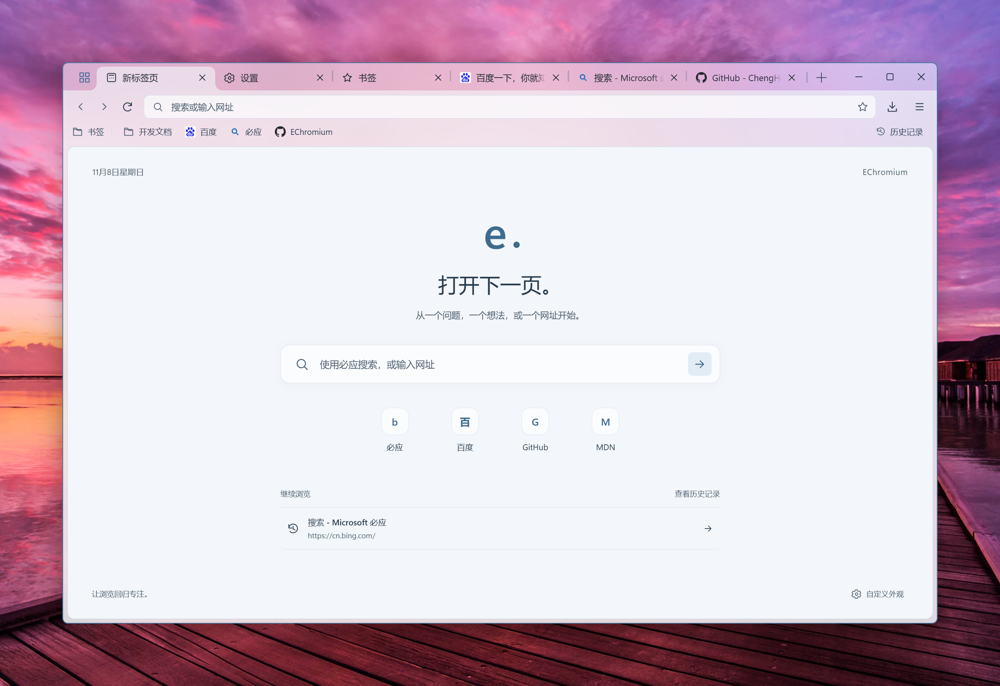
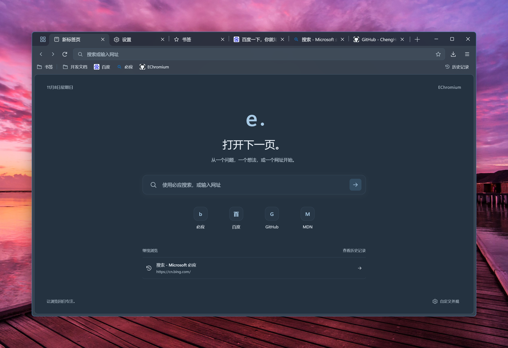
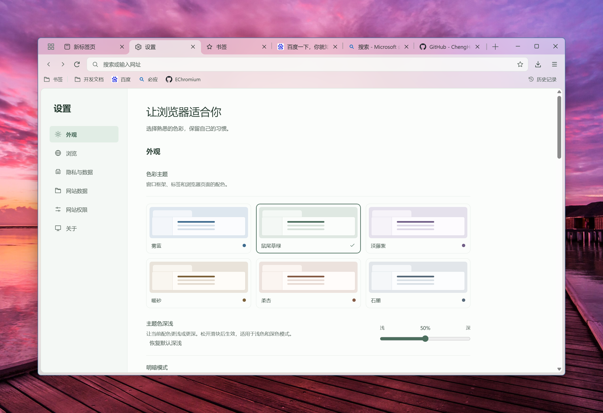
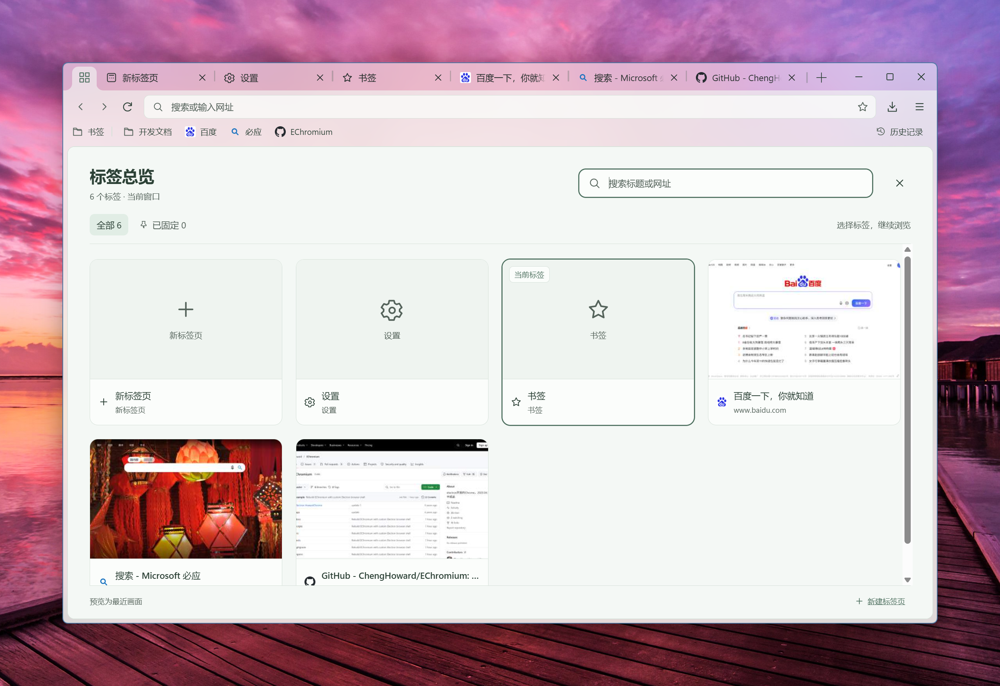
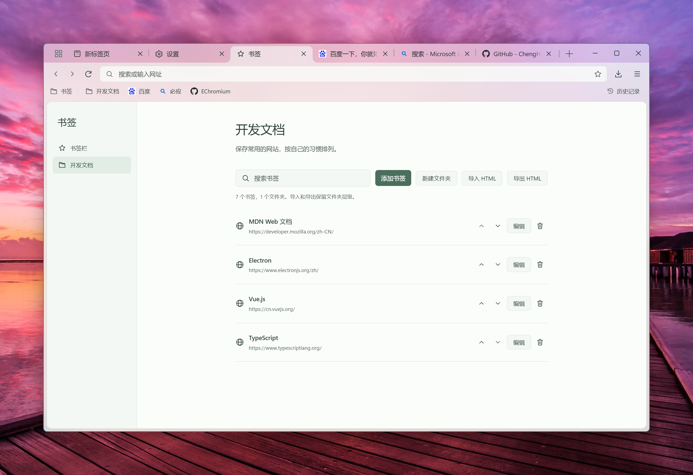

# EChromium

一个基于定制 Electron 重建的桌面浏览器，让网页、标签和日常操作回到界面的中心。

多标签浏览、标签总览、书签管理、页内查找与独立隐私窗口，搭配六组配色、自动明暗切换，以及融入桌面背景的原生半透明窗口材质。界面配色与窗口材质参考 Navora，来源见 [第三方说明](THIRD_PARTY_NOTICES.md)。

**开发预览 · Windows x64 · 定制 Electron 45.0.0-desktop.3**

[界面展示](#界面展示) · [主要功能](#主要功能) · [快速开始](#快速开始) · [开发文档](#开发文档)

## 界面展示

### 浅色 · 打开下一页

简洁的新标签页、常用网站入口，以及具有不同透色层次的标题栏和工具栏。



### 深色 · 柔和的夜间界面

明暗模式可手动选择，也可跟随系统切换。浏览器界面独立配色，不改变网页自身的主题。



### 外观 · 调成喜欢的样子

雾蓝、鼠尾草绿、淡藤紫、暖砂、柔杏和石墨，搭配可调的主题深浅与窗口透明度。



### 标签总览 · 在打开的页面之间选择

点击左上角按钮或按 `Ctrl+Shift+A` 平铺当前窗口的标签，按标题、网址搜索，直接切换或关闭。已载入网页支持最近画面预览。



<details>
<summary>查看书签管理界面</summary>

支持嵌套文件夹、搜索、整理，以及 HTML 导入和导出。



</details>

截图更新于 2026 年 11 月 8 日，使用独立演示资料，包含百度、必应及项目主页等公开网站。窗口周围保留真实桌面背景；半透明效果随系统设置、壁纸及窗口位置变化。

## 主要功能

- **标签与窗口**：站点图标、标签自动压缩、固定、静音、重开关闭标签、批量关闭、跨窗口移动与合并；普通窗口支持启动恢复，后台标签延迟加载。
- **地址与导航**：网址输入与搜索，本地匹配已打开标签、书签和历史；网站信息入口可查看原生连接与证书面板。
- **书签与记录**：书签栏、嵌套文件夹、搜索编辑、删除撤销、HTML 导入导出，以及历史和持久下载记录。
- **网页操作**：原生悬浮查找面板、结果计数、大小写匹配、页面缩放、下载进度与另存为；新标签打开保留网页表单与来源关系。
- **隐私与网站数据**：独立隐私会话、摄像头／麦克风／位置／通知权限、Cookie 属性、网站存储用量、逐站清除及按时间清除浏览记录。
- **外观与交互**：六组浅深配色、跟随系统、主题深浅调节、有范围限制的透明度、标签进出动效，以及对系统减少动态效果和透明度设置的适配。

当前版本仍在持续重构。扩展、密码管理、完整多资料、PWA、同步和安装更新尚未完成；下载暂不支持重启续传，恢复标签只重新打开网址，不重放表单提交。已实现范围与限制见 [实现状态](docs/implementation-status.md)。

## 快速开始

需要 **Windows x64** 和 **Node.js 22.12 或更新版本**。项目使用定制 Electron 发行包，不能直接替换为官方同版本运行时。

```powershell
git clone https://github.com/ChengHoward/EChromium.git
cd EChromium
npm ci

$env:ELECTRON_MIRROR='https://github.com/ChengHoward/edist/releases/download/'
$env:electron_config_cache="$PWD\.cache\electron"
node node_modules/electron/install.js
npm run runtime:prepare -- --source node_modules/electron/dist/electron.exe

npm start
```

依赖安装默认跳过安装脚本，因此需要单独下载、准备运行时。准备脚本复制完整运行时到项目目录并校验锁定的文件摘要，不修改原安装目录。已准备好运行时的工作区可直接执行 `npm start`。

也可以使用本机同版本的定制运行时：

```powershell
npm run runtime:prepare -- --source 'D:\path\to\electron.exe'
npm start
```

浏览资料默认保存在 `.local/user-data`，与旧版用户目录分离；运行时、缓存、个人资料和测试产物均不提交到仓库。

## 开发与检查

```powershell
npm run dev        # 界面热更新；主进程和 preload 改动后需重启
npm run typecheck  # 类型检查
npm test           # 领域测试
npm run build      # 构建
npm run review:ui  # 多主题截图与可见文字对比检查
npm run smoke      # 真实窗口与网页的集成检查
```

桌面检查使用隔离资料，结果保存在 `test-results/`。`review:ui` 检查实色界面；原生半透明材质仍需在实际桌面环境下查看。运行时升级、环境变量与检查范围见 [开发说明](docs/development.md)。

## 开发文档

- [实现状态](docs/implementation-status.md)：已完成的功能和当前限制。
- [浏览器重构规划](docs/browser-rebuild-plan.md)：整体目标、阶段与待办。
- [智能体交接文档](docs/agent-handoff.md)：代码入口、界面约定、验证方式和接续建议。
- [Chromium 标签布局对照](docs/chromium-tab-layout.md)：标签尺寸、图文间距、按钮状态与长标题渐隐。
- [原生标签与多会话设计](docs/chromium-native-tabs-customization.md)：下一阶段设计草案，其中新增接口尚未实现。
- [开发说明](docs/development.md)：运行时准备与升级、资料隔离、验证和目录结构。
- [站点图标](docs/favicon-lifecycle.md)：持久缓存、更新、隐私隔离和当前实现边界。

旧版 `app.js`、`app/` 和 `package.legacy.json` 保留作参考，新入口不再加载它们。旧版历史保存在 `codex/legacy-before-rebuild-20261107` 分支；原有说明见 [旧版 README](docs/legacy-readme.md)。

参考代码及第三方许可见 [THIRD_PARTY_NOTICES.md](THIRD_PARTY_NOTICES.md)。
