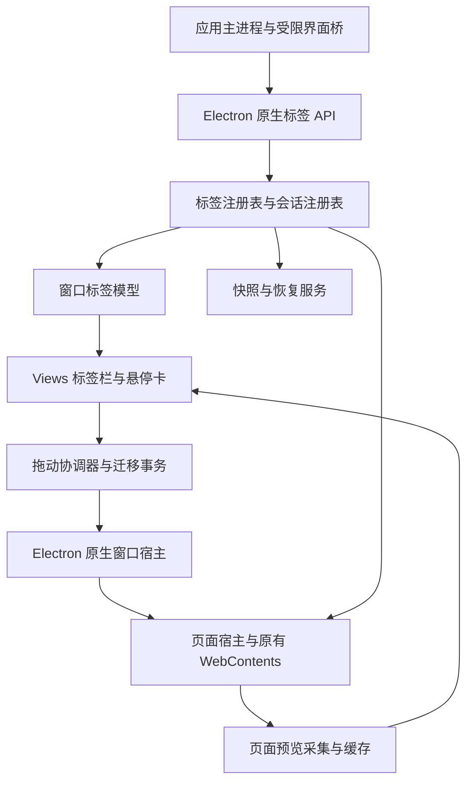
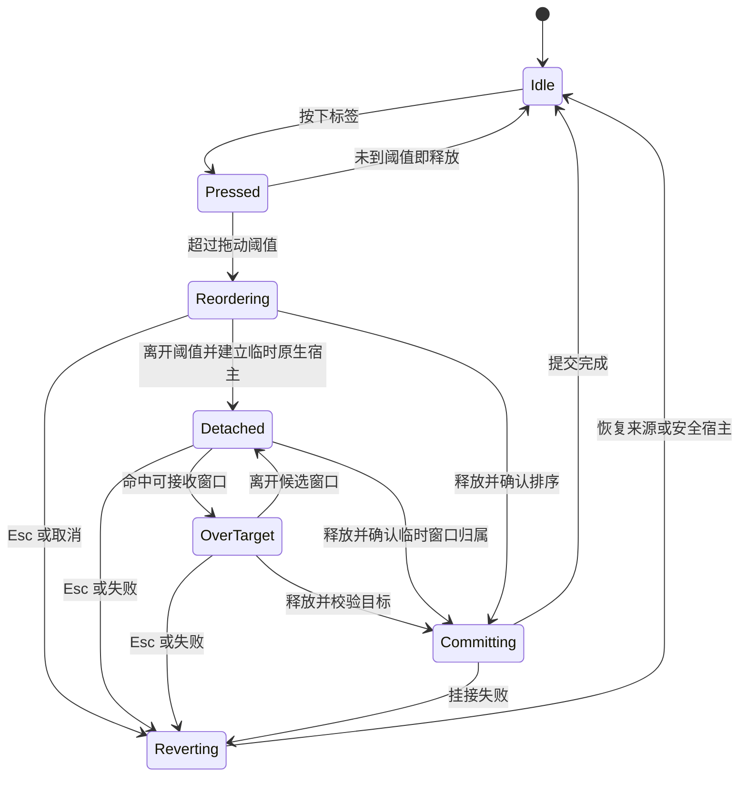
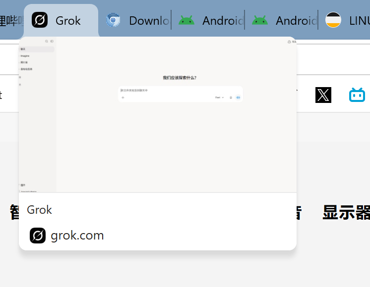
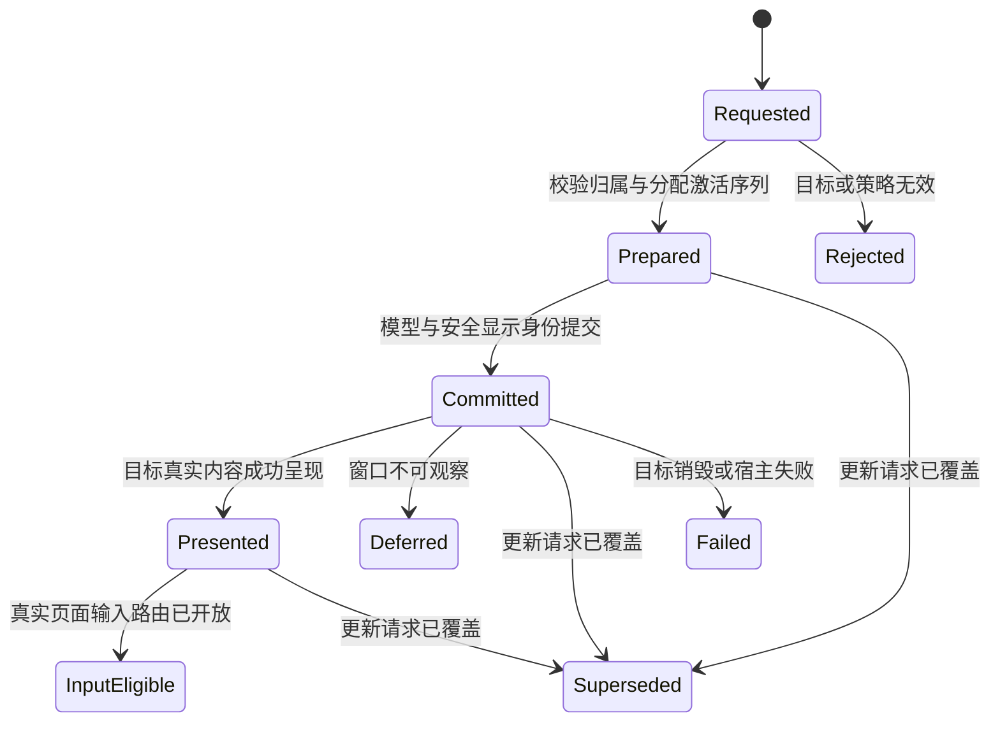

# Electron 原生标签页与多会话内核定制设计

日期：2026年11月7日。版本：1.1。状态：完整设计草案，进入原型验证前的实施依据。第 16 节规定流畅切换的实现契约和发布门槛；数值属于设计目标，尚非运行测量结果。

首发范围：Windows x64，优先 Windows 11。定制归属：desktop。本文规划原生标签系统及其与现有浏览器的接入，不代表相关接口、二进制或功能已经实现。Linux、macOS 和其他架构分别验证后声明支持。

## 1 目标与交付范围

在现有定制 Electron 中集成基于 Chromium Views 的原生标签栏，选择性移植 Chrome 标签视图、布局和拖动交互，通过 Electron 主进程 API 提供控制。窗口、标签、页面和会话分别建模，允许同一普通窗口承载多个独立会话的标签。

交付包括：

1. 原生标签栏的绘制、选择、压缩、滚动、关闭、排序、固定、多选和分组。
2. 标签拖出创建窗口、拖入已有窗口、连续拖动、取消及失败回滚。
3. 标签独立关联 session，移动时保持页面实例、会话和业务信息。
4. 原生悬停预览卡及页面缩略图，支持参考图中的排列和完整配置。
5. 标签、窗口、会话描述及业务元数据的版本化保存、异常退出恢复和旧数据迁移。
6. 与现有地址栏、网站信息、查找、权限、下载、弹窗、DevTools、材质及总览功能对接。
7. 公开类型、能力查询、行为测试、构建补丁、发行清单和升级维护机制。

现有应用的完整浏览器功能目录仍以 [浏览器重构规划](./browser-rebuild-plan.md) 为准。密码库、云同步、Chrome 账号服务和完整扩展生态不因加入标签栏而自动获得；本定制保留它们未来的接入位置。

### 1.1 必须成立的行为

- **同一标签在移动前后仍是同一个运行中的页面**。不使用重新打开 URL 模拟迁移。
- **会话跟随标签**。目标窗口的默认会话只影响新建标签。
- **同窗口可显示不同会话**。标签标题、预览、权限和站点数据不能串到另一个会话。
- **页面只有一个独占所有者**。标签模型、视图树和 Electron 包装对象不能重复释放页面。
- **迁移可提交也可回滚**。拖动取消、目标销毁和挂接失败都必须有确定结果。
- **预览不改变页面行为**。悬停不触发导航、激活、恢复休眠或桌面截图。
- **恢复按数据类别处理**。运行中迁移、关闭后重开、进程重启和崩溃恢复分别定义。
- **原生系统是状态权威**。前端接收快照和事件，不能再维护另一套可独立修改的标签真相。
- **切换具有一致的身份与画面**。活动标签、可见内容、地址/会话显示和命令路由属于同一激活序列；目标未就绪时显示其安全占位，不展示其他标签的页面。
- **流畅必须实测**。区分热页、已回收 surface、冻结、冷恢复和崩溃，不用按钮响应、截图占位或 load 事件替代真实呈现与输入结果。

### 1.2 首轮产品决策

默认使用横向原生标签栏，保留现有 Vue 地址栏、书签栏和内部页面。垂直标签、分屏、跨设备分组同步列为后续能力，首版接口保留布局和分组扩展空间。

普通窗口可混合多个普通 session，但必须属于同一应用资料和信任域。隐私窗口使用独立隐私域，只接收该隐私域内的临时标签，不与普通窗口混合。不同应用资料之间默认不允许移动；“不同 session”与“不同应用资料”不是同一个条件。

## 2 基线与现有实现

### 2.1 源码和运行时基线

- 应用工作区：`D:\Projects\EChromium`。
- 定制源码：`D:\electron\main\src\electron`，读取时 HEAD 为 `4a7c0d5b7d17c960159ef8a09ce99941379d4a63`。
- Chromium 源码：`D:\electron\main\src`，读取时 HEAD 为 `17410d037e9bd003be39fc58127823219de9aead`。
- 本地 `chrome/VERSION`：`156.0.8078.36`。
- 应用锁定发行版：`45.0.0-desktop.3`，Windows x64，见 [运行时清单](../runtime-lock.json)。
- 清单中的 executable SHA-256：`5808bd088b261cc0ad0506848a594a76b19a091aa3cac868c85b53db09e3d7ba`。

HEAD 和现有清单用于定位设计基线，不能证明工作区无未提交修改，也不能证明该发行包具有本文新增能力。新构建必须另记补丁集、实际文件摘要和运行报告。

### 2.2 应用层已有能力

当前 [browser.ts](../src/main/browser.ts) 管理窗口和标签；`Host` 保存 session，`Tab` 保存页面 View 和状态，尚未形成逐标签会话模型。

[tab-transfer.ts](../src/main/tab-transfer.ts) 已通过移动实际 View 保留页面，并在失败时恢复列表、激活状态、页面挂接和代次。但兼容条件要求窗口的 private、profile、session 一致。新方案需要改造整个上下文路由，不能只删除 session 相等判断。

[tab-previews.ts](../src/main/tab-previews.ts) 已为总览提供内存缩略图，具有并发限制、超时和过期结果检查。它是应用层的一次性捕获服务，不是原生悬停卡的完整实现。

[window-session.ts](../src/shared/window-session.ts) 的 v1 重启快照主要包含窗口位置、标签 URL、标题、固定、静音和缩放，没有完整 session 描述与稳定标签身份。运行期重开关闭标签能保存经过裁剪的导航条目；当前代码主动排除 `pageState`，避免保存表单和 POST 敏感内容。

网站数据、权限、下载、弹窗等模块也存在按窗口或资料路由的假设，必须与标签模型一起迁移。

当前 `activate()` 先隐藏原 View，再更新活动标签、布局和焦点，最后通过 IPC 发布 UI 状态。这个顺序本身不能保证新页面与 Vue 地址栏在同一屏幕帧对应，也没有对目标内容实际呈现的确认。原生模式需要第 16 节的激活协调、身份门控和呈现跟踪。

## 3 Chrome 代码的复用边界

### 3.1 不能直接封装整个现成标签系统

本地 Chrome 标签模型 `TabStripModel` 接受 `Profile*`；`tabs::TabModel` 会取得 `WebContents` 的独占所有权、安装 Chrome TabHelpers 和 TabFeatures，并将 BrowserContext 转成 Profile。Electron 的 BrowserContext 不是 Chrome Profile，不能通过强制转换接入。

`TabStripModel` 内部多处依赖具体 `tabs::TabModel`，后者为 final。因此仅实现 `TabInterface`，不能保证原模型原样可用。

原版 `TabDragController` 通过 Chrome BrowserView 寻找目标、通过 Chrome 窗口工厂创建窗口，并明确拒绝不同 Profile 的窗口。原版悬停控制器也依赖 Chrome 的窗口、偏好、性能与协作服务。相关 GN target 还会引入大量 Chrome 浏览器目标。

这些约束使“把标签栏类加入 Electron 构建，再包几个 JS 方法”不足以实现本需求。具体证据见第 24 节。

### 3.2 主路线

采用**选择性移植原生 Views 组件和交互算法，适配 Electron 页面与窗口宿主**：

- 优先复用 Tab、TabStyle、布局、动画、命中测试、Bubble、缩略图订阅，以及可抽离的拖动算法。
- 为模型、窗口查找、窗口创建、主题、命令、会话和页面所有权增加清晰的 Electron 接口。
- 对必须修改的 Chrome 代码形成独立补丁；对分离维护的组件记录上游路径、基线和后续合并方法。
- 不为满足接口伪造 Profile，不引入 Chrome 账号、同步、协作和其他无关服务。
- 不把 HTML 标签栏或简单的 WebContentsView 管理器当成本目标的完成品。

P0 原型决定哪些类通过依赖注入保留，哪些类需要维护解耦后的移植版本。若无法将依赖收敛到可维护范围，先调整移植边界；不将这一风险推迟到全部业务接完之后。

## 4 总体架构



以下名称为拟新增的设计组件，不是当前 Electron 已有 API：

- `NativeTabRegistry` 保存稳定标签身份、运行句柄、所属窗口、会话关联和元数据。
- `NativeTabStripModel` 管理某个窗口的顺序、激活、多选、固定和分组，向视图提供数据。
- `NativeTabStripView` 负责 Views 绘制、布局、动画、鼠标、触摸和无障碍。
- `NativeTabWindowHost` 适配 Electron 窗口、内容布局、坐标、窗口工厂及焦点。
- `NativeTabDragCoordinator` 管理拖动、目标命中、捕获、连续移窗和取消。
- `NativeTabTransferTransaction` 管理标签及相关页面的迁移、提交和回滚。
- `NativeTabActivationCoordinator` 统一切换请求、模型提交、焦点交接、覆盖请求和完成语义。
- `NativeActiveTabProjection` 与 `TabContentPresenter` 负责工具栏身份投影和目标内容的视觉交接。
- `TabFrameReadinessTracker` 验证目标页面的 surface、布局及成功呈现，`TabResourcePolicy` 管理受预算约束的驻留与恢复。
- `SessionRegistry` 将逻辑 sessionId 绑定到唯一后端上下文，管理策略及资源引用。
- `TabPreviewService` 管理采集、失效、缓存、压缩和图片生命周期。
- `TabHoverCardController` 与原生卡片视图负责悬停行为和可定制呈现。
- `TabRestoreService` 负责版本化快照、关闭重开、异常恢复和旧格式迁移。

浏览器 UI 线程负责状态变更和 Views 操作；压缩、文件写入等任务进入合适的工作序列。异步任务返回 UI 线程时检查对象弱引用和代次，不在 UI 线程阻塞等待 JS、网络或磁盘。

### 4.1 页面所有权

首选保留 Electron 现有 `InspectableWebContents` 的页面所有权。原生标签对象通过稳定的受控句柄关联页面宿主，并保证页面 API 包装和 View 包装在整个迁移期存活。

标签模型不再取得同一个裸 `WebContents` 的第二份 `unique_ptr`。窗口视图树管理挂接关系，不能被当作独立销毁页面的第二条生命周期。

本地 `WebContentsView` 析构会销毁页面，因此迁移必须重挂仍存活的原视图；不能销毁原包装，再用同一个页面重建包装。P0 要明确强引用、原生视图所有者、移除节点行为和销毁顺序，并测试 JS GC。

### 4.2 标签与窗口生命周期

页面生命周期区分 `unloaded`、`live`、`discarded`、`crashed`、`closing`、`closed`。加载、可见性、冻结、捕获和迁移是独立维度，不能用一个互斥枚举取代所有组合。冻结能力按当前运行时实际支持暴露；迁移不等于关闭。

拖动时可由迁移事务暂时持有标签。任何时刻，一个标签只能属于一个窗口，或属于唯一一个在途事务。关闭只执行一次，页面销毁事件必须同步注销预览、命令和所有权。

## 5 窗口布局与现有界面接入

窗口从上到下包含原生标题栏和标签区域、可信 HTML 工具栏区域、页面内容区域。地址栏、书签栏高度可以变化，由受控布局接口上报；原生宿主统一计算实际 bounds。

- 原生标签栏预留系统窗口按钮、拖动空白区和最小可点击范围，保留 Windows 贴靠和系统菜单。
- 坐标以 DIP 表达；页面捕获分辨率使用源 view 的实际设备缩放。
- `titleBarOverlay`、原生 frame 和 Acrylic 通过单一布局入口协调，不能同时重复预留标题栏高度。
- 网页全屏时隐藏相应浏览器栏并重新计算内容；退出后恢复先前布局。
- 标签栏、地址建议、悬停卡、查找、网站信息和模态对话框有明确层级；悬停卡不抢占焦点。
- 内部设置、下载、历史和新标签页也具有稳定 tabId。完整原生模式为这些标签分配可独立迁移的页面宿主，可信工具栏只负责公共浏览器栏；内部页面使用最小权限的专用桥。若迁移期仍保留共享外壳中的虚拟内部标签，只能保证业务状态迁移，必须显式标为过渡能力，不能计入“保留同一运行页面”的验收。原生宿主知道当前标签类型，避免显示上一标签的页面 View。

保留现有 `BrowserWindow.webContents` 的可信外壳语义，不把它悄悄改成“当前网页”。活动页面由 `win.tabs.getActive()` 等新接口访问；`BrowserWindow.fromWebContents()`、窗口查找和活动网页归属按原有 Electron 语义适配并测试。

`BaseWindow` 的接入作为共享宿主能力规划。首轮可以先实现 BrowserWindow，但能力查询必须区分两者；不能因为都继承窗口逻辑就宣称均已支持。

## 6 标签需要保存的信息

### 6.1 稳定身份与关联

每个标签至少具有：

- `tabId`：稳定随机标识，跨窗口不变；恢复时保留身份并增加新的运行代次。
- `windowId`、`workspaceId`、`applicationProfileId` 和 `privacyDomainId`。
- `sessionId`：逻辑会话键，创建页面时确定，移动时不变。
- `openerTabId` 和必要的创建来源标记；它们是应用关联，不能代替 Chromium 的真实 opener 关系。
- 运行期 `webContentsId`、页面宿主句柄和原生视图句柄。运行 ID 不作为重启恢复身份。

### 6.2 标签展示与业务信息

记录标题、业务别名、已提交 URL、图标关联、固定、分组、标签颜色、会话显示名、静音和业务扩展信息。待导航 URL 仅保留在运行状态，持久化以已提交地址为准，不在重启时执行上次尚未提交的导航或认证回调。页面标题与业务别名分别保存，避免把业务显示名误当成网页真实性证明。

业务信息使用带命名空间的 JSON，例如 `business.accountId`、`business.projectId`、`business.taskId`、`business.note`。只接受有限深度、有限大小的 JSON 数据，不接受函数、原生对象、循环引用或未约束路径。初始建议每标签最多 16 KiB，字段长度及嵌套深度由统一校验器限制。

账号标识可以保存；密码、Cookie、访问令牌、代理凭证和解密密钥不进入标签元数据。

### 6.3 运行状态

保存加载、可前进后退、声音、崩溃、休眠、冻结、捕获、全屏、关闭确认和迁移状态。通过事件更新，默认不作为重启后直接可信的状态：例如恢复后重新计算 audible，而不是沿用上次值。

至少区分以下代次：

- `runtimeGeneration`：页面实例重建后变化。
- `documentGeneration`：主文档改变后变化。
- `ownershipGeneration`：窗口归属改变后变化。
- `activationSequence`：每窗口每次有效切换请求递增，即使从 A 切 B 又切回 A 也不复用，用于拒绝旧切换回调。
- `metadataRevision` 和全局事件 revision：状态增量与订阅对齐。
- 权限请求、预览、查找和弹窗各自的请求 token。

移动只改变所有权代次，不伪造文档导航。过期的窗口命令即使标签后来又移回原窗口，也不得重新生效。

### 6.4 可恢复信息

包含标签顺序、激活、多选的恢复策略、固定、分组、会话关联、静音、`zoomMode`、`zoomFactor`、导航条目与活动索引，以及可恢复的业务信息。

URL、导航历史、页面 `pageState` 和站点 Cookie 是不同数据，分别制定策略。文件选择、运行中的 JS、WebSocket、媒体捕获授权、DevTools 调试连接和页面指针不能通过 JSON 快照完整恢复。

## 7 多会话模型

### 7.1 会话属于页面

一个窗口可以同时承载 `work-a`、`work-b` 两个持久会话，以及普通信任域内允许的临时容器。各标签创建页面时绑定其 session 对应的 BrowserContext。

拖动到其他窗口只改变宿主。对已有页面修改 `sessionId` 不构成真实会话切换；“在另一会话中重新打开”应是明确的新建操作，并提示无法保留完整内存状态。

使用相同 session 的标签共享该 session 的站点数据和会话配置。标签数量不等于会话数量，标签也不保证独立的渲染进程。

Electron 的 session/partition 语义以 [官方 session 文档](https://www.electronjs.org/docs/latest/api/session) 及本地版本实现为依据。不同 session 提供存储与上下文隔离，不等同于独立操作系统进程或虚拟机的安全边界。

### 7.2 会话注册表

每个 session 描述包括：逻辑 ID、后端类型、partition 或规范化目录、持久性、资料与隐私域、显示名、颜色、代理配置引用、权限策略引用、预览策略、恢复策略和配置版本。

`SessionRegistry` 负责：

1. 同一个逻辑 ID 始终解析为同一个后端描述；禁止持久性或目录在使用中静默改变。
2. 统一 `fromPartition` 与 `fromPath` 的使用，防止两个逻辑描述操作同一个磁盘目录。
3. 规范化路径，处理大小写、别名和链接；拒绝越出允许数据根目录的描述。
4. 在创建页面前安装代理、协议、权限、下载与网络回调，避免首个请求绕过策略。
5. 每个 session 只注册一次共享监听器，再以真实 WebContents 查询标签归属。
6. 维护标签、弹窗、下载、Service Worker 等资源引用，提供清理和退休状态。

本地 BrowserContext 注册表对 partition 与 path 使用不同键，不能假设最终目录相同就会得到同一个对象。它也不保证关闭最后一个标签就销毁会话。逐标签无上限创建 partition 会积累进程内资源，必须限制活跃会话数、使用可复用容器，并提供可观测的容量提示。

返回既有上下文时，创建 options 不会再次生效。修改创建期配置必须拒绝、在下一次应用启动应用，或显式创建新环境，不能只改描述对象就报告成功。会话退休先阻止新使用，再等待或取消相关后台任务并清理；删除应用 Map 项不代表 BrowserContext 已释放。

### 7.3 配置作用域

- Cookie、缓存、站点存储、Service Worker、代理、网络回调和会话级 UA 默认按 session 管理。
- preload、安全 webPreferences、页面级 UA 覆盖、缩放模式等按其真实 API 作用域记录，不能一概称为逐标签配置。
- 默认同源缩放可能共享；需要独立缩放时设置 `isolated` 模式，保存模式与倍数。
- 更新共享 session 的代理或权限配置可能影响多个标签，应返回受影响标签范围。
- renderer 沙箱、上下文隔离、Node 集成和特权协议策略由宿主预设；网页不能通过标签接口降低它们。

### 7.4 默认接收策略

目标窗口检查应用资料、隐私域、信任域、宿主能力、关闭和模态状态、容量以及业务策略。不同普通 session 本身不构成拒绝条件。

普通与隐私窗口互相拒绝。同一隐私域内可以按产品策略移动，独立隐私域默认拒绝。临时业务容器与隐私模式分开表达：前者是否允许进入普通窗口，由其注册时的政策决定，不能只看 partition 是否以 `persist:` 开头。

## 8 基础标签交互

### 8.1 创建与选择

支持前台、后台、来源标签后插入、固定区边界、指定索引和指定分组。新标签默认使用窗口默认 session；从网页产生的新标签默认继承来源页面 session。

只允许一个活动标签；多选集合与活动标签分别建模。关闭活动标签后按既定相邻或最近使用规则选择后继，不让不同入口产生不同结果。

### 8.2 固定与分组

固定区保持连续，拖动和程序排序共用同一约束。分组具有稳定 ID、名称、颜色、折叠和顺序；窗口内组实例与跨窗口组身份明确区分。

首版固定标签不属于分组。固定操作同时退出原组，取消固定后的插入位置按统一规则计算；混合移动固定和非固定标签时，分别保持各区内相对顺序，目的位置通过模型约束解析。

分组可包含多个普通 session 的标签，组颜色不代表会话身份。移动部分组成员、整个组、合并同名组以及跨窗口 ID 冲突，都要有明确策略。默认不按名称自动合并，移动完整组保留逻辑 groupId，移动部分成员时创建目标窗口组实例。

### 8.3 关闭与重开

关闭走统一流程，尊重 beforeunload；批量关闭在用户取消时停止尚未关闭的部分。固定标签是否跳过由具体命令决定。页面自行关闭、菜单关闭和 API 关闭最终进入同一状态机。

关闭标签与迁移标签是不同操作。迁移不触发 beforeunload，不进入关闭历史，不计入“关闭其他标签”。重开记录按资料、隐私域和 session 分区，避免在错误账号环境重开。

### 8.4 输入与无障碍

支持中键关闭、Ctrl/Shift 多选、键盘切换与移动、上下文菜单、触摸拖动及原生焦点环。保留系统关闭快捷键和输入法行为，提供屏幕阅读器可理解的标题、选中、固定、声音和会话标签。减少动画、高对比、RTL 和长标题从首版布局考虑。

### 8.5 原生标签栏外观

提供有版本的原生外观配置：栏高、普通/固定/活动标签宽度约束、圆角与底部过渡形状、重叠、分隔线、图标和关闭按钮布局、声音与会话角标、激活/悬停/未激活配色，以及新建、总览和溢出按钮。会话颜色和分组颜色有独立区域，不能混为权限标识。

主题使用宿主 token 与受校验的覆盖值，继承现有六种配色和材质层次；不通过任意 CSS 或网页脚本改变原生控件。绘制、命中、拖动锚点和无障碍 bounds 同步变化。尺寸范围保留最小点击面积和窗口按钮区，禁止配置造成无法关闭或无法拖动。

## 9 拖动与跨窗口迁移

### 9.1 拖动状态机



操作系统捕获丢失不一律视为取消：区分正常进入窗口移动循环和真实中断。锁屏、显示器拔插、系统菜单、模态窗口、触摸取消及应用退出分别处理。

### 9.2 迁移事务

每次迁移有唯一 `transactionId`，记录来源、目标、原始顺序、多选集合、活动标签、分组、焦点和全屏信息。事务持有页面及包装对象的足够引用，阻止重复迁移与重入关闭。

1. **准备**：验证来源归属、代次、目标接收策略、容量及会话可用性。提前准备可回滚的目标宿主。
2. **分离**：暂时撤下相关浮层和过期操作，将标签和原视图转到事务控制下。此步骤不销毁页面。
3. **挂接**：接入目标视图树，更新 owner window、布局、焦点、逻辑可见性与后台节流来源。
4. **一致性检查**：核对 session、页面身份、全部移动标签及附属 UI；确认不重复拥有，也没有孤儿页面。
5. **提交**：一次性修改两个窗口模型及归属代次，产生事件和待保存快照。
6. **收尾**：提交后处理空来源窗口、关闭拖动辅助宿主、更新标题和工具栏。
7. **失败回滚**：恢复原位置、组、活动状态和原视图挂接；来源确已不可用时转入安全恢复窗口并通知应用。

原生 `SetOwnerWindow()` 当前会同步发出 owner 变化事件，因此物理挂接不天然具有对外原子性。事务进入 staging 时应保护查询与可重入命令，并暂存相关通知；提交后按确定顺序统一发布，回滚丢弃未提交通知。已有内部观察者也要审核，不能让其在半状态中销毁标签或窗口。

安全恢复宿主必须继承来源的应用资料、隐私域、信任域、安全配置和接收能力，每个标签保留原 session。不得退回普通默认窗口。创建失败时保留在途记录与必要引用，进入有界重试或受控失败流程，不能静默丢弃页面。

拖动中的布局变化可以临时展示，但不能把每次鼠标移动都提交到磁盘。外部命令须能识别 `moving` 状态；排队、取消或拒绝的结果必须明确。

### 9.3 窗口内排序

共享原生布局与命中测试，拖动图、插入位置和最终顺序使用同一算法。考虑窄标签、滚动溢出、固定边界、折叠组和多选。

拖动到标签栏边缘时有节流自动滚动；插入位置采用稳定 tabId 或模型位置 token，不能使用已经过期的前端 index。原生排序、菜单排序和 API 排序共用约束。

### 9.4 拖出创建新窗口

原生窗口工厂使用预先登记的模板创建 Electron 窗口，不调用 Chrome `CreateBrowserWindow()`。模板包括外观、最小尺寸、可信工具栏来源、宿主能力、默认接收策略和启动布局。离开吸附阈值后即可创建临时宿主并进入系统窗口移动循环，释放只确认归属；Esc 回滚并销毁辅助宿主。临时窗口不进入重启快照。

鼠标移动循环不能等待 JS 异步返回。创建所需的安全配置预先登记；实际创建后再向 JS 发事件初始化业务界面。界面未就绪时显示原生保护底色，页面继续受原宿主策略控制。

最后一个标签拖出时，来源窗口在事务结束前不能被不可逆地销毁。可以临时隐藏或保留空宿主，成功提交后关闭；Esc 仍应能回到原位置。

单标签窗口优先复用既有窗口移动行为，避免不断创建重复窗口，但需保证拖入其他窗口和取消的语义一致。

### 9.5 拖入已有窗口

仅从本应用注册的 `NativeTabWindowHost` 查找目标。不能仅凭 HWND、窗口标题或网页提供的拖动数据认定合法目标。

目标显示可接受状态和插入位置；拒绝时保持拖动并给出原生反馈。释放瞬间再次检查接收策略和代次。目标窗口使用不同默认 session 时，移入页面仍保留原会话。

多选标签作为一个事务迁移，默认全部成功或全部回滚。该保证针对仍存活的标签，不能复活已经销毁的页面。保留相对顺序和固定约束；混合会话集合逐项验证。拖入与原地排序使用相同的分组规则。

### 9.6 并发与异常

- 标签被网页自行关闭：继续执行原有 window.close 允许性检查。真正销毁为终态，中止迁移并回滚其余存活标签，再发布关闭结果；迁移期间普通用户关闭命令暂缓或拒绝，不访问失效指针。
- 页面崩溃：保留标签记录，允许迁移崩溃占位，重载仍使用原 session。
- 源或目标窗口关闭：将关闭请求与拖动事务协调，不能先销毁必要的回滚宿主。
- HTML 全屏和系统全屏：按明确策略退出或拒绝拖动，不留下全屏状态与页面挂接不一致。
- 存在文件选择器、权限确认或不可重挂的系统模态窗口：默认暂时拒绝迁移，给出可解释结果。
- 文件或外部链接拖入：使用独立路径创建新标签，不可伪装成应用内部标签转移。
- 跨进程或不同应用实例：首版拒绝“活页面转移”；需要时另做 URL/业务描述导入，并明确会新建页面。

## 10 参考图中的原生悬停卡



截图展示的是标签悬停预览卡：上部网页缩略图，下部页面标题，再下部 favicon 与域名。卡片覆盖真实网页，有圆角、阴影和边缘留白。参考图的图片像素尺寸不直接作为界面 DIP 尺寸。

本地 Chrome 有 `TabHoverCardBubbleView`，但现有初始化参数、布局和数据结构不等同于参考图，也没有完整的业务会话标识配置。需要定制视图与控制器，而不是只加一个截图方法。

### 10.1 布局与样式

原生配置覆盖：

- 启用开关、宽度、最小/最大宽高、内容边距、行间距、圆角、边框、阴影。
- 图片置顶或置底、图片与文字顺序、预览比例、图片最大高度和 `contain/cover/top-crop`。
- 捕获裁剪区域、目标像素尺寸和设备密度上限、PNG/JPEG 编码及质量；裁剪以源页面 viewport 为边界，不扩大为桌面区域。
- 标题字体、字号、行高、最大行数、省略；域名的辅助文字样式。
- favicon 尺寸和位置、会话显示名与颜色、分组、声音、加载、休眠和崩溃状态。
- 跟随系统、浅色、深色、高对比主题，以及经过校验的业务覆盖值。
- 显示延迟、跨标签切换延迟、隐藏延迟、淡入淡出、位置过渡和减少动画策略。

首个预设使用参考图排列：图片 → 标题 → favicon 加域名；session badge 可加在元信息行。卡片宽度与标签宽度解耦。建议默认宽 360 DIP、图片 16:9，允许在 240–640 DIP 内配置，并受屏幕可用区域限制。这些是初始设计值，需在视觉验收后确认。

`capture.cropRect` 使用源 viewport 的 DIP 坐标，不使用网页 CSS 像素或物理像素；省略表示当前 viewport。超界部分取与 viewport 的交集，空交集、负尺寸和非有限值返回明确错误。`targetPixelSize` 表示编码前输出像素上限，按 fit 规则保持比例；设备密度与输出上限共同限制实际读回量。裁剪和编码配置不改变真实页面大小。

### 10.2 信息来源

页面标题、已提交地址、favicon 和声音状态来自当前真实标签。业务别名、会话名和扩展字段由可信主进程提供。业务别名不能覆盖真实域名的安全表达。

域名使用安全的 URL 格式化：不展示凭证、查询参数或 fragment，处理 IDN、长域名、内部页和无主机地址。显示文本不能作为证书安全状态的替代。

图标使用原生图片对象或经校验的内存资源；限制尺寸和字节数，不接受网页提供的任意 HTML、脚本或 privileged URL。默认沿用页面已经取得的 favicon，不为展示悬停卡额外访问不受控图片站点。

### 10.3 定位与输入

卡片锚定当前标签，按目标显示器 work area 翻转、偏移或缩小，覆盖多屏负坐标和混合 DPI。右上系统按钮区、屏幕上下边缘、最大化、全屏及 RTL 都要测试。

卡片默认不激活窗口、不拿走网页输入焦点、不拦截标签拖动。拖动开始、标签关闭、窗口销毁、上下文菜单或模态浮层打开时及时隐藏。键盘无障碍描述不依赖用户一定能看到缩略图。

### 10.4 可定制图片来源

支持四种策略：原生页面捕获、可信应用提供图片、自定义占位、禁用预览。每标签覆盖会话策略，会话覆盖全局默认；隐私和安全政策的禁止优先于样式层启用。

应用 provider 异步返回图片，必须有超时、取消和大小校验。结果携带 tabId、sessionId 和文档代次；UI 线程不等待 provider。关闭图片区域同时停止对应采集订阅，不能只隐藏图像但继续高频捕获。

原生图片需要第 11 节的文档呈现证明；provider 和占位图片不要求浏览器帧标记，但必须校验当前身份、标记来源与非实时属性，且同样不能绕过隐私禁用政策。

## 11 页面缩略图服务

### 11.1 捕获对象

默认从目标 WebContents 的合成 surface 获取当前 viewport 图像，复用或抽离 `CopyFromSurface` 和按需页面捕获链路。

不使用 `desktopCapturer`、桌面截图或最前窗口截图作为默认实现，因此不会把其他应用窗口、悬停卡本身或宿主菜单当成页面内容。这里的页面预览不是整张可滚动长网页截图。

受保护媒体、无 surface、首次未绘制、GPU 重启或平台限制可能导致黑图或失败，必须有占位与状态，不能承诺全部网页内容可捕获。无需抢占页面的 DevTools/CDP 调试连接。

### 11.2 采集时机与调度

默认采用缓存加按需刷新：

1. 页面完成主要加载并经过短暂稳定期后，允许低优先级生成预览。
2. 已显示标签切到后台前后，尝试保留最近有效画面。
3. 悬停时立即使用有效缓存，无缓存才请求一次采集。
4. 卡片显示期间可选择节流刷新，卡片隐藏后取消订阅。
5. SPA 同文档变化可标脏并节流更新，不只依赖一次 onload。
6. 休眠、冻结、discarded 和尚未加载的标签不因悬停而被唤醒，使用历史图或占位。

初始预算：全局最多 2 个采集任务、每张卡片最高 2 fps、单次捕获超时 1.8 秒；无订阅且没有待执行背景快照时不持续采集。图像压缩放到工作序列，快速切换标签合并请求并让最新目标优先。以上预算需在 P0/P3 基准后确定，不是已测性能。

应用已有总览预览也应改为订阅同一服务，避免为同一标签维护两份截图和两组并发队列。

### 11.3 缓存与失效

缓存键至少包含 tabId、sessionId、运行代次、主文档代次、捕获规格和源 view 设备缩放；不可只使用 URL 或标签索引。

- 主文档导航开始时关闭旧图展示资格，成功提交后使用新文档图；导航失败只能在明确仍展示旧文档时重新启用对应图。
- 同文档 URL、标题和声音变化更新信息，不必全部清图，但可触发刷新。
- 迁移保持页面图像与标签关联，更新悬停锚点及所有权检查；跨 DPI 时按需重新采集。
- 会话清理、注销的明确业务信号、禁用预览、标签关闭和页面重建触发清理或失效。
- 延迟结果必须重新校验请求 token 和全部相关代次，不能让 A 标签的旧图覆盖 B 标签。

文档代次只证明任务对应哪个导航，不能独自证明 surface 已经呈现新页面。导航后应等待可验证的新文档首帧或对应 presentation/surface 标记；未能确认时显示占位。跨进程导航、BFCache 恢复、GPU 重建和重挂视图都要覆盖，避免新标题配旧文档图像。

压缩图、解码位图和 GPU 纹理分别计量。初始建议编码缓存上限 16 MiB、CPU 解码缓存上限 32 MiB，并设置 GPU 资源回收策略和单图上限；内存压力时按 LRU 驱逐。不能仅统计 JPEG 字节：400×250 的 RGBA 图约 0.4 MB，200 张在未计 GPU 副本时已约 80 MB。

### 11.4 隐私与清理

默认全部预览只保存在内存；临时会话和敏感标签禁止落盘。卡片标识历史预览，不将旧截图冒充实时页面。

隐私标签可以在同一隐私域内按策略显示内存预览，不传到普通窗口。隐私域结束时取消采集并清除缓存；业务另设禁采的敏感标签使用占位。该内存预览许可不包含诊断截图、自动上报和持久附件。

持久化缩略图若以后开放，必须单独显式启用，按 session 隔离目录、容量、保留期和访问权限，并纳入浏览数据清理。清 Cookie 并不会自动清掉应用自己的图片缓存，清理入口需显式处理它。

默认不把所有 session 的图片广播到可信工具栏，更不传给外部网页。总览只获得当前允许范围的图片能力或受控结果。诊断报告不默认收录真实用户预览。

敏感页面采用整标签禁用或安全占位。通用截图流程不能保证识别并遮盖页面中的所有个人信息，不以“已遮住密码框”代替隐私策略。

## 12 保存与恢复策略

### 12.1 四种场景分别处理

**运行中跨窗口迁移**保留原页面、原 session、导航栈、JS 内存和未提交表单；窗口变化仍可能触发网页可观察的尺寸或可见性变化，需要行为测试。

**关闭后重开**创建新页面，恢复原 session、位置和允许的导航数据。页面已销毁，不能保证恢复所有运行现场。

**正常重启恢复**重建持久会话和窗口，先恢复活动标签，后台标签按策略延迟加载。临时会话及其标签默认不写入快照。

**异常退出恢复**使用最近一次完整提交的快照，检查缺失会话、损坏条目和升级兼容性。对反复崩溃的页面提供安全模式或延迟恢复，不进入无提示的崩溃循环。

### 12.2 持久化格式

建议先采用单写者、单份版本化工作区快照，加临时文件、原子替换和上一版本备份。数据量增长后可迁入事务性数据库，但不能同时保留两个互不协调的写入权威。

一个逻辑提交同时包含 sessions 描述、tabs、windows、groups 和关联关系。窗口与标签不能分别独立写入，导致崩溃后同一标签出现在两个窗口或没有窗口。

拟议结构示例：

```json
{
  "schemaVersion": 2,
  "commitId": "workspace-commit-42",
  "cleanShutdown": true,
  "runtimeCompatibility": { "chromiumMajor": 156 },
  "sessions": [
    {
      "sessionId": "work-a",
      "backend": { "kind": "partition", "partition": "persist:work-a" },
      "persistence": "persistent",
      "applicationProfileId": "default",
      "privacyDomainId": "normal",
      "configVersion": 1
    },
    {
      "sessionId": "work-b",
      "backend": { "kind": "partition", "partition": "persist:work-b" },
      "persistence": "persistent",
      "applicationProfileId": "default",
      "privacyDomainId": "normal",
      "configVersion": 1
    }
  ],
  "tabs": [
    {
      "tabId": "tab-a",
      "sessionId": "work-a",
      "kind": "web",
      "committedUrl": "https://example.com/",
      "pinned": true,
      "muted": false,
      "zoom": { "mode": "isolated", "factor": 1 },
      "restore": {
        "mode": "navigation-only",
        "activeIndex": 0,
        "entries": [{ "url": "https://example.com/", "title": "工作 A" }]
      },
      "metadata": { "business": { "accountId": "account-a" } }
    },
    {
      "tabId": "tab-b",
      "sessionId": "work-b",
      "kind": "web",
      "committedUrl": "https://example.com/",
      "pinned": false,
      "muted": true,
      "zoom": { "mode": "isolated", "factor": 1 },
      "restore": { "mode": "url-only" },
      "metadata": { "business": { "accountId": "account-b" } }
    }
  ],
  "windows": [
    {
      "windowId": "window-a",
      "defaultSessionId": "work-a",
      "tabOrder": ["tab-a", "tab-b"],
      "activeTabId": "tab-b",
      "normalBounds": { "x": 80, "y": 80, "width": 1280, "height": 800 },
      "maximized": false,
      "groups": []
    }
  ]
}
```

Session 站点数据库继续由 Chromium/Electron 管理，快照只引用它们。快照不包含 Cookie、缓存副本、凭证、运行指针、临时权限请求和图片字节。落盘前按 session 持久性过滤临时标签，包括普通窗口内的临时容器，再修正 sessions 描述、窗口顺序、活动项、多选、分组、opener 引用、关闭历史和业务索引；没有可保存标签的窗口不写入。

窗口默认 session 若为临时环境，按预先声明的恢复策略选择新的默认创建环境，或要求用户选择；不得改变已恢复标签的原 session。临时环境的真实身份与业务信息不进入持久配置。

启动恢复前原子记录本次运行尚未正常退出，只有最终快照和必要退出步骤成功后才将 `cleanShutdown` 设为 true。写入失败或退出超时保留未正常退出状态及诊断结果，不将每次运行期快照都标为正常退出。

### 12.3 导航历史和高保真恢复

本地 Electron 导出的 NavigationEntry 包含 `url`、`title`、可选 `pageState`。`navigationHistory.restore()` 只能对尚未开始导航的新页面执行，应先绑定正确 session，再恢复历史，避免先 loadURL 再 restore。

默认沿用现有隐私策略：保存安全导航条目，不保存 pageState，不自动重放 POST。高保真恢复作为单独可配置等级，尽力恢复滚动和部分表单；不能承诺 JS 堆、WebSocket、WebRTC、文件选择和未完成请求现场。

pageState 是 Chromium 的序列化数据，Base64 不是加密。启用时记录兼容版本、校验大小与格式，评估表单值、POST、referrer 和文件路径，按平台安全存储能力保护。去除密码数据也不等于已去除全部敏感信息。

`sessionStorage` 的 namespace 不在上述三个导航字段内。若要求跨重启恢复 sessionStorage，需要独立原生 namespace 方案和测试，不能把 `flushStorageData()` 或注入脚本复制当作完整恢复机制。

相关 API 的尽力恢复语义见 [NavigationHistory 官方文档](https://www.electronjs.org/docs/latest/api/navigation-history)。跨 Chromium 大版本时先校验兼容，失败降级为安全 URL 或恢复占位，保留可用条目。

### 12.4 Cookie 与登录状态

当前本地网络上下文明确设置 `restore_old_session_cookies=false`、`persist_session_cookies=false`。因此，持久 partition 不代表没有过期时间的会话 Cookie 也会跨重启保留，更不能承诺所有站点都保持登录。

默认沿用现有行为。若产品要求“重开浏览器继续账号会话”，新增**会话 Cookie 恢复策略**作为单独定制项，在 NetworkContext 创建前配置，分别控制写入和恢复，并与是否执行会话恢复关联。

该策略必须覆盖正常退出、崩溃、网络服务重启、登出、清理、过期以及隐私会话；临时/隐私上下文始终不能因此写入持久 Cookie。策略不会延长服务端登录有效期，也不应通过将 Cookie 明文导出到标签 JSON 实现。

### 12.5 损坏与迁移

校验 schema、唯一 tabId、session 引用、窗口归属、分组引用、URL scheme、字符串长度和总量。重复归属、未知 session 或不允许的数据目录不能悄悄回退到默认 session。

缺失会话的标签显示“会话不可用”并允许用户选择恢复方式；不会自动在另一个账号中打开。损坏主快照先尝试已验证备份，失败后隔离原文件并建立可诊断的空工作区。

旧 v1 数据只按已知旧模型迁移到 `persist:echromium-default-v1`，生成稳定 ID 并保留原文件备份。依据是旧保存逻辑仅持久化普通 default 资料窗口，default 资料对应此 partition。更早的 `preferences.tabs` URL 数组也要迁移，只恢复实际存在的 URL，不虚构旧标题和历史。不从 URL、标题或账号名猜测 session。窗口位置适配当前显示器，处理负坐标、工作区变化及最小尺寸。

站点数据库与应用快照不共享同一个磁盘事务。退出时保存、flush 和等待都有超时及失败记录，不能把调用了 flush 宣称为绝对不会丢数据。

## 13 页面行为与附属服务

### 13.1 弹窗和新标签

网页发起的新窗口默认继承来源标签的真实 session、安全 webPreferences 和必要的 opener 语义。目标窗口默认 session 不参与覆盖。

对于已有 Chromium 创建的 guest，采用受控接管并保留 POST 请求体、referrer、命名目标复用、noopener/noreferrer 和浏览上下文关系；不能取出 URL 再 loadURL。后台打开不抢焦点，明确弹窗尺寸或窗口语义按策略保留独立窗口。

接管前检查页面是否已有所有者，避免两份 View 包装。网站自行关闭只作用于其合法页面，来源关闭不错误销毁已独立接管的新标签。弹窗限流、拦截和授权按来源标签及 session 路由，移动后查询当前窗口。

### 13.2 权限、认证和对话框

权限决策至少包含 sessionId、请求来源、顶层来源、权限类型和需要时的 frame 身份。持续站点规则与一次性页面授权分别管理。

跨窗口提交后，旧窗口提示和旧 token 不能再批准新归属标签的请求；可以重新发提示或按能力安全重挂。已经合法运行的媒体流不因普通移窗被随意停止，是否保持连续由真实测试证明。

HTTP/代理认证、客户端证书、文件选择、打印、JavaScript 对话框和下载另存为都要检查父窗口。不可迁移的系统模态状态可以暂时阻止拖动。证书安全数据仍来自当前真实 WebContents，不使用标签显示文本推导。

### 13.3 下载和后台资源

下载绑定 session 和原始来源标签，展示归属可以随标签更新，但关闭标签不默认取消下载。关闭最后一个窗口时按产品策略处理进行中的下载，不能销毁它仍使用的会话资源。

session 清理需区分“清站点数据”“关闭全部相关页面”“退休该会话”。不能因为原窗口关闭就清理已移入其他窗口标签的存储。

Service Worker、共享 Worker、WebSocket、音频、WebRTC 和屏幕共享都可能超出可见页面生命周期。容量和退出策略不能只数当前窗口中的标签。

### 13.4 查找、总览、DevTools 和快捷键

查找、地址建议、网站信息和悬停卡在迁移时先撤销旧锚点和请求，必要时在新窗口重新打开。不要将旧原生面板继续挂在原 HWND 下。

DevTools 仍绑定原页面，不因截图而被占用。验证停靠和独立 DevTools 的移窗、焦点、关闭和 owner 变化；有 debugger 客户端时不能擅自 detach。

总览沿用真实标签身份并共用预览服务；迁移后原总览不能操作旧归属。网页快捷键发往活动页面，浏览器命令发往当前宿主，不长期捕获创建标签时的 Host。

### 13.5 内部协议和扩展

内部页面协议、权限处理和 preload 按所使用 session 正确注册。外部网页不能导航到具有宿主权限的内部源，标签拖动数据也不能授权网页调用主进程接口。

未来扩展的 `tabs/windows` 适配需使用稳定标签注册表，并依据扩展权限提供受限视图；接入本定制不自动获得 Chrome 扩展 API 或商店兼容性。

## 14 Electron 接口草案

本节全部是**拟新增接口**，不能直接在当前 `45.0.0-desktop.3` 上运行。命名在 P0 后冻结，语义和安全边界先确定。

### 14.1 能力、会话和窗口

```js
const { app, BrowserWindow, nativeTabs } = require('electron')

await app.whenReady()

const capabilities = nativeTabs.getCapabilities()
if (!capabilities.nativeTabStrip || !capabilities.mixedSessions) {
  throw new Error('当前运行时不支持所需原生标签能力')
}

nativeTabs.registerSession({
  sessionId: 'work-a',
  backend: { kind: 'partition', partition: 'persist:work-a' },
  applicationProfileId: 'default',
  privacyDomainId: 'normal',
  display: { label: '账号 A', color: '#4c789b' },
  previewPolicy: { enabled: true, persistence: 'memory-only' }
})

nativeTabs.registerSession({
  sessionId: 'work-b',
  backend: { kind: 'partition', partition: 'persist:work-b' },
  applicationProfileId: 'default',
  privacyDomainId: 'normal',
  display: { label: '账号 B', color: '#627c59' },
  previewPolicy: { enabled: true, persistence: 'memory-only' }
})

nativeTabs.registerWindowTemplate('browser', {
  windowOptions: { width: 1280, height: 800, minWidth: 650 },
  trustedToolbar: { file: '/absolute/path/to/browser-ui.html' },
  acceptPolicy: 'same-profile-and-privacy-domain'
})

const win = new BrowserWindow({
  width: 1280,
  height: 800,
  nativeTabs: {
    enabled: true,
    windowTemplateId: 'browser',
    defaultSessionId: 'work-a',
    acceptPolicy: 'same-profile-and-privacy-domain'
  }
})

// win.webContents 继续是可信外壳。
await win.loadFile('/absolute/path/to/browser-ui.html')

const tabA = await win.tabs.create({
  url: 'https://example.com/',
  sessionId: 'work-a',
  active: true,
  metadata: { business: { accountId: 'account-a' } }
})

const tabB = await win.tabs.create({
  url: 'https://example.com/',
  sessionId: 'work-b',
  active: false
})
```

模板不接受任意网页指定的路径、preload 或安全选项。宿主能力及初始化顺序必须一致，不能在原生拖动已经创建窗口后再临时补安全配置。

能力对象包含 API 版本、原生标签栏、混合会话、跨窗口拖动、分组、悬停卡、捕获、高保真恢复、BrowserWindow/BaseWindow 和平台支持范围。API、GN 开关与 capability 以同一实现为源，不能只看发行版后缀判断支持。

### 14.2 标签操作

```js
await win.tabs.activate(tabB.id)
await win.tabs.move(tabB.id, { beforeTabId: tabA.id })
await win.tabs.update(tabB.id, { pinned: true, muted: true })
await win.tabs.updateMetadata(tabB.id, {
  business: { accountId: 'account-b', projectId: 'project-1' }
})

await nativeTabs.moveToWindow(tabB.id, {
  targetWindowId: otherWindow.id,
  beforeTabId: targetTab.id,
  expectedOwnershipGeneration: tabB.ownershipGeneration
})

await nativeTabs.detachToNewWindow(tabA.id, { templateId: 'browser' })
const closeResult = await otherWindow.tabs.close(tabB.id)
```

`otherWindow` 和 `targetTab` 代表应用已取得的合法目标。移动返回最终结果和 revision；关闭返回成功、用户取消或失败。导航、移动和关闭等异步操作都必须有取消/对象销毁语义。

`sessionId` 不允许通过 update 改写。另提供明确的 `reopenInSession` 或 `duplicate` 操作，说明会创建新页面及哪些状态可以复制。复制不默认导出表单、Cookie 或运行内存。

主进程可通过受控接口取得当前活动页面，以复用已有导航和网站信息能力。renderer 只获得允许的状态和命令，不获得 Session、WebContents 或文件系统对象。

### 14.3 悬停卡与预览

```js
win.tabs.setHoverCardOptions({
  enabled: true,
  layout: 'preview-top',
  width: 420,
  showDelayMs: 400,
  fields: ['title', 'favicon', 'domain', 'session', 'status'],
  preview: {
    enabled: true,
    aspectRatio: 16 / 9,
    fit: 'contain',
    mode: 'cached-on-demand',
    captureOnBackground: true,
    maxFrameRate: 2,
    wakeDiscardedTabs: false,
    persistence: 'memory-only',
    capture: {
      region: 'viewport',
      targetPixelSize: { width: 840, height: 472 },
      maxDeviceScaleFactor: 2,
      format: 'jpeg',
      quality: 75
    }
  },
  appearance: {
    mode: 'system',
    cornerRadius: 14,
    titleMaxLines: 2
  }
})

await tabA.setPreviewPolicy({ enabled: false, placeholder: 'sensitive' })
await tabA.clearPreview()
```

补充 `refreshPreview()`、应用图片 provider 注册及配置读取接口。禁止唤醒和隐私策略是约束，不允许普通样式更新解除它们。所有数值校验有限性和范围，图片校验格式、尺寸、字节数与解码成本。

需要局部截图时增加 `capture.cropRect`，按第 10 节的 DIP 坐标定义。`clearPreview()` 作废当前缓存和在途结果，但不禁止后续合法订阅重采；持续禁采使用 `setPreviewPolicy({ enabled: false })`。示例先禁采再清理，二者作用不同。

### 14.4 状态与事件

至少提供 created、updated、activated、selection-changed、moved、detached、attached、closed、close-cancelled、window-created、transfer-failed、session-unavailable、preview-updated、preview-failed 和 restore-completed。

通过一个原生事件流提供顺序，不让多个 JS 包装各自拼接顺序。事件带 tabId、来源/目标 windowId、transactionId、相关代次及 revision；业务信息按订阅范围裁剪。

一次跨窗口迁移先完成内部一致性更新，再发布 committed 事件批次。detached/attached 的对外通知不得让客户端把临时分离当作页面关闭。客户端发现 revision 缺口时取完整快照重同步。

激活另有 committed、content-presented、presentation-deferred、superseded 和 failed 阶段通知，不能用一个 activated 事件同时代表它们。完成点和查询规则见第 16 节。

会话 Cookie 恢复、高保真恢复与 sessionStorage 恢复分别报告 capability 和策略；未实现的扩展接口不出现在可调用能力中。

### 14.5 错误约定

使用稳定错误码或结果原因码，例如 `TAB_NOT_FOUND`、`STALE_OWNERSHIP`、`TAB_MOVING`、`SESSION_UNAVAILABLE`、`TARGET_REJECTED`、`TARGET_CLOSED`、`CAPACITY_EXCEEDED`、`CLOSE_CANCELLED`、`PREVIEW_BLOCKED` 和 `RESTORE_INCOMPATIBLE`。用户取消关闭使用结构化取消结果，程序错误才 reject，具体完成点见第 16 节。

拒绝结果不能被解释成成功。错误附带可公开的原因，默认不包含 Cookie、认证头、用户目录或完整敏感 URL。预览失败提供可展示占位，不向用户反复弹系统错误框。

## 15 存储和安全边界

可信 UI 的桥只接受已登记命令，验证调用窗口、主 frame、可信来源、当前标签归属和 payload。不得直接把全局 `nativeTabs` 能力暴露给任意网页。

原生拖动在同一应用内使用不可伪造的事务身份和注册表，系统拖放 payload 只作传递线索，不作为所有权证明。

会话目录、快照、备份及可选图片目录设定最小访问权限。敏感扩展数据采用安全存储引用；在 Windows 使用受支持的系统保护能力，其他平台能力不足时拒绝持久化敏感项。不能把 Base64 或一般 JSON 编码作为加密。

会话清理要取消在途预览和恢复任务，清除关闭历史、业务索引和可选图片。磁盘安全删除和内存清零只能按平台能力声明，不承诺不可恢复的擦除。

隐私标签的信息不进入持久快照、普通关闭历史、全局搜索、遥测、崩溃附件或自动诊断截图。同隐私域内存预览按第 11 节独立管理。日志默认记录 ID、状态和耗时，敏感 URL 脱敏；需要内容诊断时使用专门测试资料。

## 16 流畅切换与性能规范

### 16.1 体验定义和保证范围

“丝滑切换”要求标签选择及时反馈，目标内容连续、正确地出现，工具栏和会话身份同步，输入只到正确页面，并在快速切换及后台任务并发时保持稳定。标签按钮变化很快而网页停顿、先出现错误账号页面、或用不可交互截图掩盖长等待，都不能作为达标。

目标是将**热标签**切换做到接近原生浏览器的手感；基准机 60 Hz 下以一到两帧为中位体验目标、P95 不超过 50 ms 为拟议呈现门槛。冻结和已丢弃页面要恢复，首次打开还可能等待网络，不承诺任意状态、硬件和网站都能瞬间交互。

页面区域默认直接切换，不把两个账号页面做交叉淡入、不对整张网页做布局动画。标签栏本身可有轻量动画，但不得延迟激活或强制等待动画结束。减少动画模式关闭非必要过渡。

所有性能门槛在本节明确列出；P0 先登记适用硬件、基线和差异。达不到时优化或如实缩小支持范围；调整指标需要留下原因、影响和新的验收依据，不能在失败后悄悄改为“争取”。

### 16.2 页面就绪分类

每次请求开始时按真实状态分桶，记录分类依据；分类变化也要记入事件，不能事后把慢样本改成其他桶：

- **热页 hot**：原 WebContents 存活、未冻结，拥有身份正确且可用于当前布局的保存合成帧，不需创建页面、网络或解冻。静态内容也可属于热页。
- **温页 warm**：原页面存活，但 surface 被回收、尺寸/DPI 变化或没有可复用帧，需要重新合成；不与 hot 合并统计。
- **冻结页 frozen**：需要恢复页面调度，可先显示合规保留画面，但真实交互就绪另计。
- **冷页 cold**：尚未创建、discarded 或重启后延迟加载，需要按原 session 重建页面；加载和网络时间完整记录。
- **崩溃页 crashed**：先呈现该标签的崩溃状态；重载是显式恢复操作，不能伪装成热页成功。
- **不可观察呈现**：宿主隐藏、最小化或完全遮挡时可以提交逻辑激活，但不宣称屏幕已呈现。恢复可见后另建可见性恢复测量，不覆盖原来的 deferred 结果。

“已加载”不等于 hot；`HasSavedCompositorFrame()` 也不能独自证明文档、内容尺寸和设备缩放仍匹配。

生命周期、冻结、surface 可用性和系统可见性仍按独立维度存储。主性能桶为便于统计按 crashed → cold → frozen → warm → hot 的顺序归类，系统可见性作为独立标签；冻结页即使有保存帧也不混入 hot。锁屏和远程桌面断连同样按实际可观察性处理。

### 16.3 原生激活事务

采用每窗口单一协调器，所有入口，包括原生鼠标、快捷键、菜单和 JS API，都进入相同状态机：



处理顺序固定如下：

1. 接收请求先分配 requestId 和记录单调时钟，读取目标 tabId、sessionId、页面、文档、归属、布局和窗口代次。
2. 验证目标、迁移锁及窗口状态，处理同目标 no-op；只有有效的新切换才递增 activationSequence 并取得展示权，在影响合成的变化前接入 Chromium 的 tab switch 计时请求。无效请求不覆盖当前有效请求或其呈现等待。
3. 暂停旧内容区域的新输入投递，处理旧焦点、IME、pointer lock、capture 和手势；撤销旧面板锚点。
4. 准备目标内容宿主及安全的身份投影。通过平台 view/Widget 的正常链路显示、隐藏和更新布局，不绕开它直接强行调用 renderer WasShown。
5. 在受控 UI 事务内提交活动标签、命令目标和身份 revision，使原生标签栏、地址/会话显示、内容门控属于同一序列。
6. 复用目标自己的合成帧，或先呈现目标占位；注册能关联目标内容的 presentation 回调。处理目标页面的显示和焦点，保持每标签返回位置。
7. 真实目标画面达到呈现条件后开放内容输入。通知、截图、压缩、业务回调和快照写入不成为关键路径前置条件。

热路径不创建新 WebContents/BrowserContext、不重新导航、不先做截图、不等待网络、磁盘、业务 JS 结果或工具栏 IPC 往返。重复激活已是当前目标且布局不变时是 no-op，避免 Windows 上无意义 detach/attach 引起隐藏和重绘。

原生代码仍运行在浏览器 UI 调度体系内。应用主进程若执行长时间同步 JS、同步 I/O 或重入耗时回调，仍会阻塞交互；因此 API 通知应有重入保护，应用重任务移到异步序列/worker。原生化不能使被阻塞的 UI 线程自动变快。[Electron 性能指南](https://www.electronjs.org/docs/latest/tutorial/performance)

### 16.4 工具栏与页面的身份一致性

`ActiveTabProjection` 至少包含 activationSequence、tabId、sessionId、已提交地址、待导航显示状态、标题、导航能力、站点身份状态和内容状态。活动标签、窗口标题、工具栏命令和原生内容只读取同一已提交投影。

保留 Vue 工具栏时，主进程发布最小高优先级投影，renderer 回传 `toolbar-applied` 只表示其已处理布局，不能直接当作屏幕呈现证明。切换不等待这一往返才开始。

在工具栏尚未与当前序列对应时，由原生保护层覆盖地址/站点身份及会话标识区域，显示当前目标的最小身份，旧的导航控件禁用；工具栏对应帧经验证后再移除。保护层和目标内容在同一原生合成事务中协调，不能通过一帧旧地址配新页面完成交接。

P0 必须验证原生保护层与 HTML 画面的呈现握手及性能。如果无法可靠验证对应帧，保留原生身份区域作为权威显示，不用一次 IPC 到达或 Vue nextTick 替代证明；是否进一步原生化可编辑地址栏另立任务。网页内容与当前显示身份的错配帧数必须为 0。

地址栏正在编辑时尊重激活来源：原生页面切换取消旧标签的未提交地址编辑并显示新目标；由工具栏发起且声明保留编辑焦点的动作不自动聚焦网页。后台开页和后台移入不抢正在输入的焦点。

### 16.5 画面交接与防白屏

热页优先直接嵌入其自己的已保存合成 surface，不通过 GPU 读回、JPEG 或 PNG 编解码走显示关键路径。调整尺寸在挂接前完成，frame、layout、DPI 和页面代次一起验证。

目标暂不可用时，先显示带目标身份的主题占位；策略允许时可使用该标签同一允许文档的历史预览，并标明非实时且禁用内容输入。敏感标签直接占位。不能沿用上一标签图像，不调用跨标签的 fallback 内容转移来隐藏等待，也不把悬停小缩略图放大后算成真实页面已呈现。

背景色由窗口、内容宿主和占位统一控制，避免空隙露出默认白底；网页自身合法的白色内容保留。主题背景不是首帧证明，不能靠颜色一致掩盖缺帧。

真实 `content-presented` 同时要求：当前激活序列仍有效；tab/session/文档/窗口/布局代次匹配；目标 surface 已被嵌入目标可见内容区域；与其关联的合成帧获得成功 presentation feedback。只等窗口的下一帧可能等到标签栏动画或占位帧，不能据此报告内容出现。

优先复用 `SetTabSwitchStartTime`、VisibleTimeRequestTrigger 和 content-to-visible 计时链，并补足目标 surface/frame_token 的归属验证。WasShown、did-finish-load、first-paint、合成 ACK、视图 addChild 完成和 Promise resolve 都不能替代这一条件。现成接口是 C++ 接入点，不是当前 Electron 已公开的新事件。

### 16.6 快速切换与并发规则

同一窗口采用最新有效请求优先。A→B→C 时，B 未完成呈现的请求终止为 superseded；B 的迟到帧、解冻、加载、工具栏更新和焦点回调不能重新激活 B。A→B→A 也创建新的序列，不能因 tabId 再次相同而接收第一个 A 的结果。

若 B 的 activate 已返回 committed，该历史结果不追改；被覆盖的是后续呈现等待与展示权。尚未提交的激活可直接返回 superseded。取消过期展示任务不等于无故中止 B 页面已经合法发生的导航或业务。

文档、surface、布局、归属和窗口变化会使相应呈现证据失效；重新确认时沿用当前请求身份并记录子阶段。单次激活仍可能跨越多个文档/尺寸变动，不能把旧证据直接拼接。

命令政策固定为：

- 已处于当前标签且没有新变化的 activate 返回 no-op，复用当前序列和呈现状态，不取消它尚未完成的呈现；新 requestId 可关联既有序列等待，no-op 不进入实际切换分布。正在 preparing 的激活可被有效更新请求覆盖。
- 标签正在迁移时，外部 activate、close、navigate、再次移动或修改页面句柄返回 `TAB_MOVING`；拖动协调器自己的视觉预选是事务内动作。
- 已 closing/closed 的目标拒绝激活；普通关闭只与短暂的模型提交串行，不等待真实呈现或 renderer 绘制。关闭进入合法流程后终止相关呈现等待，真实销毁取消全部相关任务；beforeunload 用户取消按统一关闭语义处理。
- restoring 标签允许用户激活、排序或关闭；用户操作提升恢复优先级或取消对应恢复任务。旧启动恢复回调不得覆盖用户已做出的选择。
- 宿主销毁时所有激活请求返回确定终态；不能永久 pending。

若失败发生在模型提交前，保留原活动标签；提交后目标发生错误，保留目标身份并显示其错误状态，不偷偷切回另一个账号。用户再选择其他标签时按正常流程处理。

### 16.7 焦点和输入交接

每个标签保存焦点返回位置，激活请求指定 `restore-content`、`preserve-toolbar` 或 `no-window-activation`。这些是拟议 focus policy，后台操作不能强制激活系统窗口。

切换期间旧内容不再接收新的内容事件；原生浏览器栏仍响应切换、取消和系统命令。静态预览/占位不接受网页输入，也不缓存点击或键盘，避免等页面出现后突然提交按钮或输入。

浏览器在发送前检查输入目标和当前激活序列；已经合法发送给旧页面的事件属于旧序列，不能承诺从 renderer 队列撤回。残留 keyup、鼠标抬起和滚轮惯性不能被重新解释为对新标签的一次点击或滚动。

同时要正常完成旧序列的释放或取消，不能直接吞掉所有 keyup/鼠标释放导致按键或 capture 卡住。cursor、tooltip、选择句柄和迟到 window.focus 请求按当前目标更新，后台页面无权抢回焦点。

Windows IME 的组合文本按原生焦点变更语义确认或取消，组合串和候选窗不迁到另一页面，不用脚本重放文字。pointer lock、页面鼠标 capture、触摸手势和 Viz 输入序列按其真实接口结束或转入安全状态，不能仅换 focus 就认为完成。

区分网页 HTML 全屏与窗口级全屏：离开网页全屏标签时退出其页面全屏和相应 keyboard/pointer lock，不将权限或锁继承给目标；窗口级全屏可按用户选择保持。系统模态窗口不可安全重挂时明确拒绝切换，普通原生提示则撤销旧请求并更新锚点，不能在 B 页面为 A 授权。画中画、音频和合法媒体流不因一般切换被误销毁。

内容输入恢复要求目标实际页面已可见、输入路由有效且没有替代位图遮罩。此状态不保证任意网页 JS 及时响应；测试页的输入 ACK 单独度量 renderer 响应能力。页面卡死仍允许用户切走、关闭或重载，不能卡死整个原生标签栏。

### 16.8 资源驻留与调度

优先级从高到低为：原生输入/窗口布局与活动页面呈现 → 当前激活需要的恢复 → 拖动宿主准备 → 可见悬停/总览预览 → 后台恢复、压缩和持久化。过期任务取消，后台工作有独立并发和退让预算。

优先保留当前页面和最近使用页面的允许合成帧，在全局预算下按 LRU 管理；预算不足时明确降为 warm/cold，不无限保留所有表面。内容帧驻留、预览图片和完整页面进程内存分别统计，不能共用一个 JPEG 容量数字。

不为流畅而对全部后台标签设置 `backgroundThrottling:false`、长期 WasShown 或持续刷新。会改变逻辑可见性、影响其他同窗页面或持续耗电的优化必须独立评估，不能成为默认策略。

首版不自动 discard 活页面；以后开放自动冻结/丢弃时，默认排除正在播放声音、捕获媒体、下载关联任务、已知未保存输入、文件权限操作、调试和业务锁定页面。任意网站未保存数据不能被通用检测完全识别，自动丢弃必须有保守策略和显式允许，冻结不等于销毁。

默认后台恢复最多 2 项并行，用户激活优先并可抢占尚未开始的恢复；关闭/移动取消失效任务。预览按第 11 节并发执行，切换和拖动高压期间可以降低预览频率，不能反过来延迟激活。

### 16.9 API 完成点与可观察一致性

`await win.tabs.activate(id)` 默认在原生模型和安全身份投影 committed 后返回结构化结果，包含 requestId、status、revision 和 activationSequence。已接收请求的 status 区分 committed、no-op、superseded、cancelled；参数、归属、目标关闭和策略校验失败按稳定错误码 reject。请求得到确定结果时完成，不以此证明内容已呈现。no-op 单独计数，不能作为零耗时切换样本。

另提供可取消的 `waitForPresentation(requestId, { timeoutMs })`，只有目标内容满足第 16.5 节才返回 presented。覆盖、窗口不可观察、对象销毁、等待超时、主动取消观察、历史过期和真实呈现失败分别返回 superseded、deferred、destroyed、timeout、cancelled、expired、failed；failed 带稳定原因码，不混作 timeout。超时不自动关闭或重载页面。已提交操作的等待取消，只取消观察，不假装撤销激活；提交前取消才可以阻止该操作。

交互就绪没有通用的“网站业务完成”Promise。生产接口仅报告输入路由是否开放、页面响应状态及呈现；测试中的 input ACK 使用可控测试页，不向任意站点注入业务探针。

接口调用示意，仍为拟新增接口；假定 tabA 当前属于 win：

```js
const activation = await win.tabs.activate(tabA.id, {
  focusPolicy: 'restore-content'
})

if (activation.status === 'committed') {
  const presentation = await nativeTabs.waitForPresentation(
    activation.requestId,
    { timeoutMs: 1500 }
  )
  // 仅 presentation.status === 'presented' 证明真实目标画面出现。
  // deferred、superseded、timeout、destroyed、cancelled、expired、failed
  // 分别处理，不重放点击，也不自动重载。
}
```

支持 AbortSignal 等取消机制时，信号只作用于对应请求或等待，并按上述提交边界生效。操作结果保留有界历史，过期 requestId 返回明确失效，不能无限保存窗口和页面强引用。

关闭中的用户取消使用 `{ status: 'cancelled', reason: 'CLOSE_CANCELLED' }`，不作为程序异常 reject；参数非法、归属过期等仍按错误码 reject。移动结果在提交或回滚结束后返回，staging 中 `nativeTabs` 查询只读最近已提交快照并标 moving，页面修改请求返回 `TAB_MOVING`。

必须同时审计原有 Electron owner 事件及页面/窗口 getter：仅延迟新 API 通知不足以保证旧接口不暴露危险半状态。P0 要验证这些入口的兼容行为，未完成前不能宣称所有 Electron 观察者都获得原子迁移。

### 16.10 测量协议

全部浏览器侧时间使用同一单调时钟，跨进程 ACK 通过 trace/同步机制关联，不直接相减不同进程的未对齐时钟：

- `t_input`：原生输入到达 UI 分发的时间，系统输入生成到此的排队耗时另记；API 请求从浏览器收到命令另起统计。
- `t_commit`：活动模型、命令归属和安全身份投影提交。
- `t_feedback`：原生标签选择反馈实际呈现。
- `t_content`：目标真实内容首次满足成功呈现条件；占位和低分辨率预览不计入。
- `t_input_eligible`：目标内容路由可以接收新输入。
- `t_ack`：可控测试页收到测试输入并产生匹配 ACK，用于端到端可交互测量。

核心指标是 `t_content − t_input`，同时报告 commit、反馈、输入门禁和 ACK 耗时。冷恢复不能扣掉等待网络后再宣称热切换很快；独立报告总时长、各阶段及未完成数。

拟议发布门槛：

- hot 在登记的基准机上 P50 不超过两个刷新周期，P95≤50 ms、P99≤100 ms；60/120/144 Hz 分别实测，不外推。
- 原生标签反馈 P95≤两个刷新周期；激活事务本身的 UI CPU 耗时目标 P95≤4 ms、P99≤8 ms。
- hot 可控测试页输入 ACK 端到端 P95≤100 ms、P99≤200 ms；网页自身卡死另外报告。
- warm/frozen/cold/crashed 各自报告呈现、恢复和 ACK 分布；目标内容未就绪时，安全占位或状态反馈 P95≤100 ms。
- 工具栏对应帧完成 P95≤100 ms，之前原生身份门控持续有效。错误页面、会话身份错配和错误输入路由为 0 次。
- hot 不允许出现宿主引起的未覆盖空洞、错误历史帧或双页叠显。使用带身份标记的测试画面识别，合法白色网页不算白屏。

60 Hz 的 16.7 ms、120 Hz 的 8.3 ms、144 Hz 的约 6.9 ms 是整个刷新周期，不是可以全部占用的 UI 工作预算。记录实际呈现间隔、长帧/丢帧、UI 任务和 compositor 调度，不能只用平均 FPS 或主线程平均值验收。

### 16.11 基准矩阵与证据

基准登记 CPU、GPU/驱动、内存、磁盘、Windows 版本、功耗模式、显示器刷新率、DPI、GPU 开关和构建优化参数。分别对照当前应用、定制实现和适用的原生浏览器基线，比较同一确定性测试内容。

必测 10/50/100 标签、同会话/混合会话、空闲/预览及保存并发、前后台窗口。60 Hz 为基本验证；其他宣称支持的高刷新配置必须实测。冷/温/冻结和 GPU 重建另组，不与 hot 求平均。

每个必测 hot 组合预热 20 次，再收集至少 1,000 次完成样本、重复 3 轮，报告 P50/P95/P99/max、全部请求数、覆盖/失败/超时和排除原因。快速覆盖请求作为 superseded 单独计数，不悄悄丢弃；异常、超时不能当作零耗时加入分布。

确定性 hot 常规基准中，全部有效且未被覆盖的请求必须成功，出现实现导致的失败或超时，该轮不通过，不能靠继续追加成功样本稀释。覆盖压力为独立用例，记录所有终态和最终目标。外部环境中断单独保留证据并重跑，不静默从报告删除。

测试页用稳定色块、tab/session 文本标识、滚动位置、表单、计数器和可控输入 ACK；用 trace 及必要的测试屏幕采样交叉检查实际内容。真实网站是补充兼容结果，不替代可重复主基准。

窗口隐藏或遮挡时记录 deferred，恢复后测量到可见；不借保持所有后台页面持续绘制取得虚假成绩。30 分钟并发负载和反复切换记录资源趋势，100 次跨窗往返核对对象、页面、观察器与辅助窗口数。

默认沿用每窗口 100 标签、总计 200 标签、10 个可恢复窗口。300 标签仅在显式提高容量的压力配置下测试。预览码流、解码/GPU 内存、真实内容帧、页面进程、后台唤醒和 session 数分别计量；超预算时按政策降级并留下记录。

## 17 实施阶段与完成条件

### P0 原生依赖与所有权原型

产物：可独立构建的最小原生标签 target、依赖清单、所有权设计记录及真实运行报告。

必须跑通：原生标签栏显示 → 同窗口两持久会话加一临时容器 → 窗口内排序 → 拖出 → 拖入不同默认会话的窗口 → Esc 回滚。全链路确认页面身份、session、脚本计数、表单、导航及连接状态。

同步完成激活原型：本地 hot 页面与温/冷页面分别切换，工具栏原生身份门控、目标 surface 的成功呈现、A→B→A 覆盖和输入交接必须可测。记录第 16 节性能基线、关键路径及保留帧资源成本。

同时验证标题栏布局、GC、最后标签、目标销毁、预览 surface、混合 DPI 和典型模态状态。此阶段决定可复用原类与移植类的名单，冻结页面单一所有权。

**进入 P1 的门槛**：无 Profile 强转、无双重拥有、无重新导航模拟迁移；依赖规模可接受；迁移与流畅切换闭环具有运行证据。不能证明身份一致或目标真实呈现时不得进入完整业务迁移。

### P1 原生标签模型与基础 API

实现稳定身份、会话注册、窗口宿主、创建/激活/关闭/排序/固定/多选、命令校验、事件和能力查询。保留工具栏外壳语义，接通网页和内部标签。

完成条件：单窗口多会话、统一关闭、事件顺序、键盘/无障碍、布局与生命周期回归通过，前端不再独立修改标签真相；第 16 节热切换、身份一致和输入门禁达到登记门槛。

### P2 完整拖动与窗口协调

实现原生窗口工厂、窗口注册表、目标命中、插入预览、连续拖动、组与多选迁移、提交和回滚。接通权限、弹窗、DevTools、查找和下载归属。

完成条件：全部拖动异常用例通过；移走最后标签和 Esc 正确；同一 WebContents/session 的连续性具有断言与真实输入证据；移窗后立即切换及混合 DPI 呈现仍符合身份和输入规范。

### P3 悬停卡与统一预览

实现参考图预设、样式和字段配置、捕获调度、缓存失效、会话标识、隐私与异常占位，接通总览复用。

完成条件：图片不串会话、不串文档、不唤醒休眠；视觉/DPI/焦点验收通过，采集和图片资源在退出后释放。

### P4 保存恢复与旧数据迁移

实现 schema v2、原子快照、备份、重开、异常恢复、延迟加载和旧 v1 迁移。默认隐私策略先上线；高保真、会话 Cookie 恢复及 sessionStorage 恢复分别作为有独立门槛的扩展包，不影响基础恢复验收。

完成条件：正常/崩溃/损坏/升级/缺失会话/退出超时均有确定结果；临时标签不落盘；恢复不串账号，不重放 POST。

### P5 应用迁移与定制发行

替换现有 HTML 标签栏及对应控制逻辑，保留工具栏和业务页面；补全分组和视觉细节，完成完整浏览器回归、性能基线、公开类型和发行验证。

完成条件：新旧模式按启动配置可选；每次运行只有一个标签管理权威；构建、运行、安装和应用接入证据均齐全，并通过第 16 节分桶性能与第 19.8 节发布门槛。新能力进入新的 desktop 发行，不修改旧 desktop.3 的能力记录。

### 17.1 排期与任务拆分原则

先排 P0，再根据需要解耦的原生依赖确定后续工期。任务按模型、宿主、拖动、预览、恢复、应用适配和发行拆分，每项带明确行为及证据，不以新增类数量衡量进度。

阻塞关系为 P0 → P1 → P2；P3 在页面身份和宿主稳定后推进，P4 依赖稳定模型；P5 需要前面全部通过。架构可以并行开发，但窗口/会话/标签协议的变更必须在同一版本契约下合并。

## 18 现有 EChromium 迁移清单

1. `src/main/browser.ts`：Tab 增加 sessionRef，Host.session 改为默认创建配置；状态读取切到原生注册表。
2. `src/shared/model.ts`：补稳定 ID、sessionId、privacyDomain、分组、恢复与代次字段，生成最小 UI 投影。
3. `src/main/tab-transfer.ts`：由原生事务替代实际 View 移动，保留应用业务通知；删除旧 session 相等约束前先完成全部路由。
4. `src/main/tab-previews.ts`：改为原生预览服务适配，保留当前总览请求范围和过期 token 检查。
5. `src/shared/window-session.ts` 与 `storage.ts`：升级格式，建立原子提交和 v1 迁移。
6. `src/main/permissions.ts`：按标签真实 session 和来源决定权限，保留旧窗口失效保护。
7. `src/main/site-data.ts`、`site-inventory.ts`、`site-storage.ts`、`browsing-data.ts`：明确当前标签会话与全资料操作范围，清理确认显示受影响 session。
8. `src/main/downloads.ts`：注册与展示按 session 和稳定来源路由，不重复注册监听器。
9. `src/main/popups.ts`、`page-dialogs.ts`、`page-find.ts`、`address-suggestions.ts`：查询标签最新 owner，撤销迟到操作。
10. `src/main/material.ts` 和 renderer 布局：将原生标签高度计入单一几何来源，防止工具栏、页面圆角和浮层错位。
11. renderer 标签栏组件：关闭旧排序/拖放和标签状态写入；保留业务菜单入口并调用新接口。
12. `scripts`、`tests`、运行时清单：补能力检查、原生真实输入测试、恢复进程测试和新发行摘要。

13. `activate()`、renderer 状态投影与布局发布：替换“先隐藏再异步广播”的松散流程，接入 activationSequence、原生身份保护层、工具栏帧确认、present 跟踪和 focus policy。保存与预览退到激活关键路径之外。

特别复核“最后一个同 profile 窗口关闭时清数据”的旧逻辑。混合 session 后应根据相关页面、弹窗、下载和任务引用决定清理，不能清掉已移走标签仍使用的会话。

默认在启动时选择原生或旧模式，不在运行中把一批活页面重建为另一模式。遇到运行时不支持时可选择旧模式启动并明确提示；原生运行中迁移失败应回滚，不以重载全部标签作为隐式降级。

## 19 验收用例与证据

以下是待实现的验收清单，未勾选表示尚未运行验收。每一组报告记录实际 executable/类型摘要、系统版本、DPI、测试资料、配置、预期、结果和失败证据。自动断言与真实桌面输入分别报告，不能用合成 DOM drop 证明原生拖动已经可用。

### 19.1 模型与基础操作

- [ ] MOD01 创建前台/后台标签，顺序、焦点、session 与来源正确。
- [ ] MOD02 创建、激活、排序、固定和关闭的 API、菜单、鼠标入口结果一致。
- [ ] MOD03 关闭当前、其他、左右及多选标签，beforeunload 取消正确停止。
- [ ] MOD04 页面自行关闭或崩溃后，没有重复销毁、僵尸标签和错误整窗关闭。
- [ ] MOD05 快速操作、JS GC 与包装对象释放不影响存活页面。
- [ ] MOD06 固定区、分组、折叠、多选与组 ID 冲突规则正确。
- [ ] MOD07 内部页跨窗保留自己的页面与草稿；过渡虚拟标签单独报告。
- [ ] MOD08 屏幕阅读器、键盘、多选、触摸、RTL 和减少动画可用。

### 19.2 会话隔离

- [ ] SES01 同窗口三个 session 打开相同站点，Cookie、LocalStorage、IndexedDB 和账号标识互不串用。
- [ ] SES02 sessionStorage 按页面/浏览上下文语义验证，不误当作单纯的 session 全局字典。
- [ ] SES03 同 session 共享效果符合预期，代理和权限变更报告影响范围。
- [ ] SES04 相同逻辑键复用，partition/path 目录别名冲突被拒绝。
- [ ] SES05 不同默认 session 的目标窗口可接收标签，页面 session 保持不变。
- [ ] SES06 普通与隐私、不同隐私域、不同应用资料按策略拒绝。
- [ ] SES07 关闭来源窗口不会清除移走标签的会话，下载和 Worker 引用仍有效。
- [ ] SES08 超过会话数量限制得到明确错误，反复创建/关闭不无限增长。
- [ ] SES09 同源独立缩放保存 mode/factor，不改变其他标签的缩放。

### 19.3 原生拖动

- [ ] DRG01 窗口内排序、窄标签、固定边界、溢出滚动和组边界正确。
- [ ] DRG02 拖离阈值建立临时窗口，连续移动过程与指针位置一致。
- [ ] DRG03 拖入已有窗口的插入预览、前后台状态及释放位置正确。
- [ ] DRG04 原窗最后一个标签拖出后提交关闭，Esc 能恢复来源。
- [ ] DRG05 连续经过多个窗口，多选/整组迁移保留顺序、会话及元数据。
- [ ] DRG06 同一 WebContents 身份、导航索引、JS 计数、未提交表单、Cookie 和 sessionStorage 在移动后保持。
- [ ] DRG07 移动没有新导航和 beforeunload；WebSocket、音频和合法媒体流的连续性分别测量。
- [ ] DRG08 Esc、目标销毁、挂接失败、窗口工厂失败和系统捕获中断可回滚。
- [ ] DRG09 页面在途销毁时其余标签回滚，不复活销毁页面。
- [ ] DRG10 staging 期间同步 owner 事件、查询和 JS 重入不能看到半提交状态。
- [ ] DRG11 多 DPI、多屏负坐标、最大化、贴靠、全屏和显示器拔插正确。
- [ ] DRG12 外部拖放、伪造 tabId、旧代次和跨应用实例不能接管活页面。

### 19.4 悬停卡与截图

- [ ] PRE01 参考图排列可配置实现，标题、favicon、域名及会话标识正确。
- [ ] PRE02 图片尺寸、裁剪、比例、编码、主题、圆角、阴影和字体配置有效。
- [ ] PRE03 三个 session 相同 URL 的预览不混用，跨窗口后仍对应原标签。
- [ ] PRE04 快速划过 20 个标签及异步乱序返回时无错图、闪图和崩溃。
- [ ] PRE05 主文档导航、跨进程导航、BFCache 和 GPU 重建不出现新标题配旧图。
- [ ] PRE06 遮挡、最小化、无 surface、未加载、休眠、崩溃、SPA 和受保护媒体有正确状态。
- [ ] PRE07 悬停不激活、不重载、不恢复休眠，不截到桌面和其他应用。
- [ ] PRE08 全局并发、帧率、压缩、解码/GPU 缓存和取消均遵守预算。
- [ ] PRE09 禁用策略、清会话和关闭标签后，无在途结果复活旧图。
- [ ] PRE10 100%/125%/150%/200% 缩放和混合 DPI 下定位、清晰度与屏幕边界正确。
- [ ] PRE11 临时/敏感预览不落盘，不进入日志或普通资料搜索。
- [ ] PRE12 provider 超时、异常、大图和非法格式安全降级，不阻塞拖动。
- [ ] PRE13 清缓存后合法订阅可重新采集；禁采后不得重采，裁剪坐标和输出像素上限正确。

### 19.5 保存恢复

- [ ] RST01 多窗口、多 session、固定、分组、选中、缩放与业务信息正常重启后正确。
- [ ] RST02 后台延迟加载不触发不必要请求，恢复活动页使用正确 session。
- [ ] RST03 强杀、写入中断、主快照损坏和备份损坏有确定降级。
- [ ] RST04 快照中无双窗口重复拥有、悬空会话、无效分组和临时标签引用。
- [ ] RST05 缺失会话不在默认账号中自动打开；路径别名和越界路径被拒绝。
- [ ] RST06 导航恢复在新页面首次导航前执行，不重放 POST。
- [ ] RST07 隐私/临时标签的 URL、标题、历史、业务信息和图片不出现在持久文件及备份。
- [ ] RST08 v1 及更早 URL 数组迁移保留备份、范围正确、重复运行不重复生成标签。
- [ ] RST09 不兼容 pageState、非法编码和超长数据不会使全部恢复失败。
- [ ] RST10 Cookie 默认与可选恢复策略分别测试退出、崩溃、登出、清理和失效。
- [ ] RST11 若开放高保真或 sessionStorage 扩展，单独报告恢复覆盖率和无法恢复的数据。
- [ ] RST12 cleanShutdown、退出超时与磁盘失败状态真实，站点数据库不被错误宣称与快照原子。

### 19.6 附属能力与安全

- [ ] INT01 原生 POST 弹窗、命名目标、opener、noopener/noreferrer 与后台开页保持原语义。
- [ ] INT02 迁移后旧窗口权限回复和旧面板动作失效，已批准权限按策略处理。
- [ ] INT03 下载、文件选择、认证、客户端证书、打印和系统模态父窗口正确。
- [ ] INT04 停靠/独立 DevTools、已有 debugger、查找、网站信息和总览均保持正确归属。
- [ ] INT05 Node 关闭、沙箱、上下文隔离、可信来源检查和内部协议边界持续有效。
- [ ] INT06 session 清理、注销及隐私窗口结束同时处理缓存、历史、索引和在途任务。
- [ ] INT07 地址栏、NativePanel、材质、圆角及滚动条等现有 desktop 功能无回归。
- [ ] INT08 100 次往返和容量压力后对象、辅助窗口、监听器及图片资源无持续泄漏。

### 19.7 证据分层

模型测试验证所有权不变量、顺序、分组、策略、快照和事件；Electron 集成测试使用真实页面与本地测试服务验证 Cookie、POST、连接和恢复。原生桌面测试验证捕获、窗口移动、命中、DPI、焦点和视觉。

首次原生拖动验收必须包含真实鼠标或触摸链路。测试可以在隔离桌面/测试窗口运行，但不能通过修改生产逻辑、关闭沙箱、固定成功返回或仅模拟 DOM 事件通过。

视觉证据按主题与 DPI 保存测试资料截图，参考图用于比对布局，不要求网页自身内容完全相同。性能结果保存分位数、样本数、机器配置和资源上限；失败、跳过与未测分别记录。

### 19.8 流畅切换与输入一致性

- [ ] SWI01 hot/warm/frozen/cold/crashed 按第 16 节归类，保存分类依据，不将慢样本事后移桶。
- [ ] SWI02 记录原生输入、API 接收、commit、选择反馈、目标呈现、输入开放与 ACK，不用 load/ACK/占位冒充真实内容。
- [ ] SWI03 hot 的 P50/P95/P99、UI 事务和输入 ACK 达到基准门槛，no-op 和 superseded 不混入完成分布。
- [ ] SWI04 60 Hz 与声明支持的 120/144 Hz 分别测量，记录长帧/丢帧与端到端时延，不由平均 FPS 推断。
- [ ] SWI05 每个必测组合满足样本和三轮要求，所有超时、失败、排除及配置可追溯。
- [ ] SWI06 不同 session 同域不同账号切换，活动标签、工具栏、页面和命令始终同一身份，错配为 0 次。
- [ ] SWI07 延迟 Vue/IPC 和工具栏帧时原生身份门控有效，nextTick 或 IPC 收到不能提前撤去保护。
- [ ] SWI08 A→B→C、A→B→A 和键盘/鼠标混合切换中，故意延迟旧帧、旧焦点和旧投影，不得回抢目标。
- [ ] SWI09 目标准备期发生导航、关闭、迁移、DPI/尺寸变化，旧 presentation 失效，所有等待都有终态。
- [ ] SWI10 热路径没有重新创建页面、重新导航、同步截图、编码、磁盘写入或等待业务 JS/IPC 返回。
- [ ] SWI11 温/冻结/冷页面先显示正确状态，安全保留图不可交互，点击和文字不在恢复后重放。
- [ ] SWI12 中文预编辑/候选窗打开时点击标签、Ctrl+Tab、Esc、拖出/拖入，不串字、不丢失释放状态，真实输入到正确页面。
- [ ] SWI13 网页输入框、地址栏、跨源 iframe、查找、DevTools 与总览返回的 focus policy 正确，后台移入不抢焦点。
- [ ] SWI14 按住键或鼠标、触控板惯性、触摸、页面 capture/drag 中切换，无卡键、卡捕获或新标签误滚动。
- [ ] SWI15 全屏、pointer/keyboard lock、权限提示、认证和系统模态切换，状态及授权不泄漏到目标。
- [ ] SWI16 原页面 renderer 长任务/失去响应时仍能选择其他标签；不宣称故意阻塞浏览器 UI 线程后仍能流畅。
- [ ] SWI17 页面合法白色、主题切换、无 surface、GPU 重启和跨进程导航，无宿主空洞、错页及不合法旧帧兜底。
- [ ] SWI18 遮挡、最小化、锁屏、RDP 断连期间激活记 deferred；恢复只显示最新目标，不虚报此前已呈现。
- [ ] SWI19 在 50/100 标签、混合会话、预览/恢复/保存并发和 30 分钟负载下复测，切换优先级与资源预算有效。
- [ ] SWI20 不以全部后台常驻绘制、关闭所有节流或无限帧缓存达标，内存压力降级有记录且不丢页面身份。
- [ ] SWI21 启动恢复中用户激活、排序、关闭后，旧恢复任务不抢焦点、不恢复已关标签或覆盖新布局。
- [ ] SWI22 activate/waitForPresentation 的提交、取消、超时、覆盖和销毁语义正确；旧 getter/owner 事件无法重入破坏迁移。
- [ ] SWI23 注销、清数据、禁预览后切回，不出现旧敏感图片或过期在途结果。
- [ ] SWI24 移窗完成后立即切换并真实点击，混合 DPI 下画面、坐标、owner、焦点和 session 一致。

发布需同时满足功能、身份/输入零错配和分桶性能门槛。缺少 presentation 证据、样本不足或只有截图演示，不能标为“丝滑切换已验收”。

## 20 源码组织和维护策略

建议新增 Electron 模块位置如下，具体文件名在 P0 后确定：

```text
electron/shell/browser/native_tabs/
  native_tab_registry.*
  native_tab_record.*
  native_tab_strip_model.*
  native_tab_window_host.*
  native_tab_drag_coordinator.*
  native_tab_transfer_transaction.*
  native_tab_activation_coordinator.*
  native_active_tab_projection.*
  tab_content_presenter.*
  tab_frame_readiness_tracker.*
  tab_resource_policy.*
  native_tab_session_registry.*
  native_tab_restore_service.*
  tab_preview_service.*

electron/shell/browser/ui/views/native_tabs/
  native_tab_strip_view.*
  native_tab_hover_card_view.*
  native_tab_hover_card_controller.*

electron/shell/browser/api/
  electron_api_native_tabs.*

electron/lib/browser/api/
  native-tabs.ts
```

若 Chrome 代码适合抽成共享组件，则新增独立 GN target，保持 Chrome 原路径通过适配器使用共享逻辑；若必须维护移植副本，则在文件头记录上游来源和 revision，并保留许可证。两种方式都要记录差异清单，避免后续升级时只能人工猜测。

禁止为了链接标签栏直接引入整个 `//chrome/browser`。构建依赖清单区分必须基础设施与被移除的 Chrome 服务；新增 Chromium 改动进入 Electron `patches/chromium` 并登记 `.patches`。

`BUILD.gn`、`filenames.gni`、绑定模块清单、API 文档、公开类型生成、测试和资源包同时修改。沿用既有类型生成流程，避免只手改发行 `electron.d.ts` 而漏掉源定义。

内置文案复用适用的 Chromium GRIT/locale 资源，Electron 专属文案增加正式本地化资源。业务会话名由应用提供，语言切换不等于自动翻译业务字符串。保留字体回退、长文本和 RTL 测试。

## 21 构建与发行要求

遵循 [定制开发编译与更新规范](D:/electron/main/docs/定制开发编译与更新.md)。本功能归属 desktop，不据此修改 foundation 发行的能力声明。

建议在既有 desktop 定制开关下增加原生标签子功能构建开关，并提供启动期禁用和能力查询。准确名称由实现确定；关闭后不能残留到 Chrome 专有服务的链接依赖，普通 Electron 窗口仍应可用。

发行前完成：

1. 固定 Electron/Chromium/Node 版本、源码提交、未提交差异、补丁顺序、GN 参数、工具链和输出目录。
2. 运行新模块及受影响的现有 desktop 回归，生成原生交互、恢复和性能报告。
3. 验证资源、locale、沙箱、类型、平台能力和启动降级。
4. 用独立新版本产物记录 executable、ZIP、npm 包和类型文件摘要，不覆盖旧版本证据。
5. 从实际发行包在独立目录安装，执行能力查询和应用接入验收，再更新运行时清单和依赖锁。
6. 更新 `main/docs` 与 `src/electron/docs/zh` 的功能说明、简述、详述、支持矩阵和开发说明。
7. 若后续要求发布，再核对发行附件、校验和、镜像和消费者版本一致性；本规划阶段不执行发布。

维护一个受支持的版本分支和补丁来源记录。升级 Chromium 时重点复核 TabInterface/TabModel、窗口接口、拖动 move loop、Views 布局、缩略图和导航序列化变化。安全更新应能独立重放定制补丁，不能因标签系统冻结网页安全修复。

## 22 风险与决策记录

### 22.1 P0 必须关闭的问题

- **原生依赖是否可收敛**：输出实际 target 图、移除服务列表及可编译原型。
- **页面由谁拥有**：保留 Electron 所有权为首选，明确包装存活、GC 和最终销毁路径。
- **窗口是否能安全重挂**：验证原生视图、owner 同步事件、系统移动循环和回滚。
- **混合会话是否全链路成立**：页面、弹窗、权限、预览和存储均以标签真实 session 为准。
- **截图能否确认新文档画面**：确定 surface/presentation 证据，不能只依赖标题或导航回调。
- **BrowserWindow 外壳是否保持兼容**：验证主页面销毁、窗口关闭与所有标签关闭协调，不误触发旧单页面逻辑。
- **切换是否能正确且可测地呈现**：验证原生身份保护层、工具栏对应帧、目标 surface/presentation 关联和输入门禁；不能只证明标签模型变化。
- **资源成本是否可持续**：给出 hot 驻留策略、低内存降级及预览/恢复并发下的基准，不依赖所有后台长期绘制。

### 22.2 已选默认与独立扩展

默认保留普通/隐私边界、只在内存保存预览、排除 pageState、沿用会话 Cookie 策略；可选高保真恢复、会话 Cookie 恢复、sessionStorage 恢复与持久预览分别开发及验收。

同窗口多 session、原生拖出/拖入和参考图悬停卡属于核心交付，不能降为“以后可选”。垂直标签、分屏、跨进程活页面迁移和跨设备同步不进入首版完成条件。

### 22.3 风险的处置方式

依赖扩大时先缩小原生复用单元，保留产品行为与 API 契约；不得通过伪造 Chrome Profile 或关安全检查消除编译障碍。模态、受保护内容和平台不支持的能力采用明确拒绝或占位。

业务信息可能持续增加，因此采用有版本的命名空间和配额，而不是不断向原生核心添加业务专属字段。应用保留业务含义，内核保证归属、迁移、序列化及访问边界。

## 23 第一轮可执行任务

按以下顺序启动实施，无需先重写现有整个浏览器：

1. 建立隔离开发分支及测试数据目录，记录当前补丁和运行时，不改用户真实资料。
2. 新增最小标签 target，确定原生 View/布局和 Electron 宿主接口。
3. 固定页面所有权与 staging 机制，完成单窗口两个真实 session 页面。
4. 接通临时窗口工厂、拖出/拖入/Esc 和最后标签；加入身份连续性断言。
5. 完成激活事务、身份门控、目标成功呈现和 IME/输入交接原型，建立同/混合会话热切换基准。
6. 做一个参考图布局的原生悬停卡，验证真实 surface 来源和失效，并确认不会阻塞切换。
7. 提交 P0 设计记录、原型运行证据和依赖规模评估，再冻结公开接口。

P0 的验收资料必须能回答：实际复用了哪些 Chrome 原生组件、维护了哪些解耦副本、额外引入哪些服务，以及同页面/同会话迁移有哪些已验证边界。之后才据此排 P1–P5 的详细人力和日期。

## 24 源码与资料索引

下列本地链接按本次读取的源码行号定位；后续提交可能移动行号，应结合第 2 节基线使用。

### 24.1 标签模型、拖动与所有权

- [Chrome TabStripModel 构造及 Profile 依赖](D:/electron/main/src/chrome/browser/ui/tabs/tab_strip_model.h:216)。
- [Chrome TabModel 的页面所有权与 TabHelpers](D:/electron/main/src/chrome/browser/ui/tabs/tab_model.cc:52)。
- [TabModel 为 final](D:/electron/main/src/chrome/browser/ui/tabs/tab_model.h:33)，[模型中的具体类型转换](D:/electron/main/src/chrome/browser/ui/tabs/tab_strip_model.cc:689)。
- [Profile 从 BrowserContext 转换的前提](D:/electron/main/src/chrome/browser/profiles/profile.cc:271)。
- [拖动创建 Chrome 窗口](D:/electron/main/src/chrome/browser/ui/views/tabs/dragging/tab_drag_controller.cc:2875)，[查找 BrowserView](D:/electron/main/src/chrome/browser/ui/views/tabs/dragging/tab_drag_controller.cc:3036)，[拒绝不同 Profile](D:/electron/main/src/chrome/browser/ui/views/tabs/dragging/tab_drag_controller.cc:3101)。
- [原生拖动回滚参考](D:/electron/main/src/chrome/browser/ui/views/tabs/dragging/tab_drag_controller.cc:2155)，[保留标签的 detach/insert 接口](D:/electron/main/src/chrome/browser/ui/tabs/tab_strip_model.h:296)。
- [现有标签栏 GN 依赖](D:/electron/main/src/chrome/browser/ui/views/tabs/BUILD.gn:407)。
- [Electron InspectableWebContents 页面所有权](D:/electron/main/src/electron/shell/browser/ui/inspectable_web_contents.cc:341)。
- [WebContentsView 析构](D:/electron/main/src/electron/shell/browser/api/electron_api_web_contents_view.cc:58)，[重挂时的窗口归属](D:/electron/main/src/electron/shell/browser/api/electron_api_web_contents_view.cc:180)。
- [SetOwnerWindow 与同步事件](D:/electron/main/src/electron/shell/browser/api/electron_api_web_contents.cc:3106)。
- [BrowserWindow 单主页面生命周期](D:/electron/main/src/electron/shell/browser/api/electron_api_browser_window.cc:69)。

### 24.2 会话与恢复

- [创建页面时选择 session/partition](D:/electron/main/src/electron/shell/browser/api/electron_api_web_contents.cc:1117)。
- [partition 的持久与临时语义](D:/electron/main/src/electron/shell/browser/api/electron_api_session.cc:1806)。
- [BrowserContext 注册表身份和进程内生命周期](D:/electron/main/src/electron/shell/browser/electron_browser_context.cc:314)。
- [导航条目序列化](D:/electron/main/src/electron/shell/browser/api/electron_api_web_contents.cc:443)，[恢复前置条件](D:/electron/main/src/electron/shell/browser/api/electron_api_web_contents.cc:3916)。
- [独立的 SessionStorage namespace](D:/electron/main/src/content/public/browser/navigation_controller.h:707)。
- [当前会话 Cookie 持久化和恢复开关](D:/electron/main/src/electron/shell/browser/net/network_context_service.cc:111)。
- [页面缩放模式](D:/electron/main/src/electron/shell/browser/api/electron_api_web_contents.cc:7406)。
- [现有应用旧格式保存范围](../src/main/browser.ts:481)，[关闭记录排除 pageState](../src/main/browser.ts:958)。

### 24.3 悬停卡与图片采集

- [原生悬停卡类及参数](D:/electron/main/src/chrome/browser/ui/views/tabs/hovercard/tab_hover_card_bubble_view.h:39)，[当前布局](D:/electron/main/src/chrome/browser/ui/views/tabs/hovercard/tab_hover_card_bubble_view.cc:383)。
- [悬停控制器的 Chrome 宿主依赖](D:/electron/main/src/chrome/browser/ui/views/tabs/hovercard/tab_hover_card_controller.cc:239)。
- [卡片数据模型](D:/electron/main/src/chrome/browser/ui/views/tabs/hovercard/hover_card_anchor_target.h:28)。
- [切后台截图与 CopyFromSurface](D:/electron/main/src/chrome/browser/ui/thumbnails/thumbnail_tab_helper.cc:242)。
- [页面视频捕获而非桌面截图](D:/electron/main/src/chrome/browser/ui/thumbnails/background_thumbnail_video_capturer.cc:39)。
- [缩略图 token 与异步压缩](D:/electron/main/src/chrome/browser/ui/thumbnails/thumbnail_image.cc:74)。
- [Electron capturePage 与设备缩放](D:/electron/main/src/electron/shell/browser/api/electron_api_web_contents.cc:7220)。
- [用户参考图](./images/native-tabs/hover-card-reference.png)，SHA-256：`673a03ebc40d4220d5b47debfad58138ea8f03ccac81eabc197b2a2f6dbd7e3b`。

### 24.4 流畅切换与真实呈现

- [应用现有 activate 的隐藏、布局和发布顺序](../src/main/browser.ts:574)，[工具栏状态 IPC](../src/main/browser.ts:450)。
- [记录切换开始、加载与保存帧/冻结参数](D:/electron/main/src/content/public/browser/web_contents.h:1789)。
- [Chrome 在合成变更前记录切换时间](D:/electron/main/src/chrome/browser/ui/tabs/tab_strip_model.cc:4277)。
- [WasShown 与页面可见性更新](D:/electron/main/src/content/browser/web_contents/web_contents_impl.cc:3179)。
- [Aura 保存帧与新帧的显示路径](D:/electron/main/src/content/browser/renderer_host/render_widget_host_view_aura.cc:712)。
- [DelegatedFrameHost 嵌入 surface 与成功呈现请求](D:/electron/main/src/content/browser/renderer_host/delegated_frame_host.cc:93)。
- [成功呈现接口](D:/electron/main/src/ui/compositor/compositor.h:363)，[合成 ACK 与呈现的区别](D:/electron/main/src/ui/compositor/compositor_observer.h:48)。
- [实际 content-to-visible 呈现时间与失效](D:/electron/main/src/third_party/blink/common/page/content_to_visible_time_reporter.cc:237)。
- [Views WebView 原生宿主挂接](D:/electron/main/src/ui/views/controls/webview/webview.cc:119)，[Chrome 切换时保存与恢复焦点](D:/electron/main/src/chrome/browser/ui/views/frame/browser_view.cc:1984)。
- [输入隔离及既有输入序列限制](D:/electron/main/src/content/public/browser/web_contents.h:1714)。
- [跨 view 借用 fallback 内容的接口](D:/electron/main/src/content/public/browser/render_widget_host_view.h:309)：不能用于不同标签身份的兜底。
- [本地 Electron 对绕过平台 view 直接 WasShown 导致白屏的说明](D:/electron/main/src/electron/shell/browser/api/electron_api_web_contents.cc:3260)。

### 24.5 官方 API 与项目规范

- [Electron WebContentsView](https://www.electronjs.org/docs/latest/api/web-contents-view) 和 [BaseWindow](https://www.electronjs.org/docs/latest/api/base-window)：页面视图与窗口组合；资源关闭需按所有权处理。
- [Electron Session](https://www.electronjs.org/docs/latest/api/session)：会话创建、共享及站点数据接口。
- [Electron NavigationHistory](https://www.electronjs.org/docs/latest/api/navigation-history)：导航条目、恢复方法及尽力恢复边界。
- [Electron 性能指南](https://www.electronjs.org/docs/latest/tutorial/performance)：主进程 UI 线程阻塞与后台工作安排。
- [本地定制开发规范](D:/electron/main/docs/定制开发编译与更新.md)：desktop 边界、补丁、测试、类型、镜像及文档同步要求。
- [当前浏览器实现状态](./implementation-status.md) 与 [产品功能总规划](./browser-rebuild-plan.md)：本定制之外的能力和既有实现记录。

官网 latest 文档用于核对公开概念，实际编译和验收以锁定的本地源码及新产物为准。规划、源码存在、编译通过、运行验收、安装验证和发布是不同状态，后续记录分别更新。
